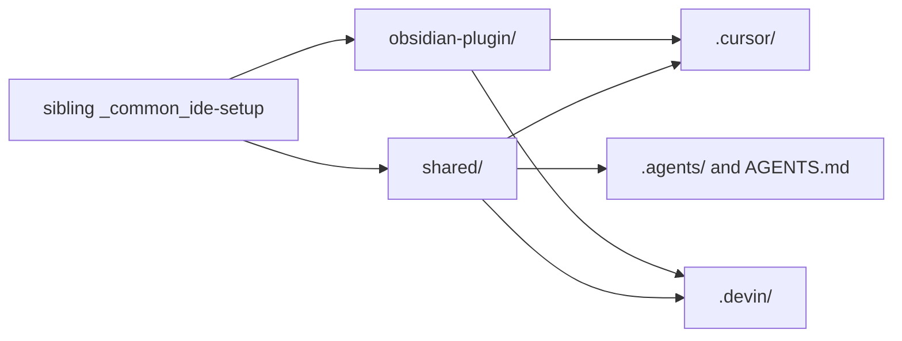

# Agent tooling

## Conceptual understanding

Cursor, Devin, and Antigravity share one set of commands and rules so a task runs the same way in each tool. The source is the sibling checkout `_common_ide-setup` (the reference repo; its own README asks to be added to a workspace as `_reference_ide-setup`). This plugin takes the `shared/` tree plus the `obsidian-plugin/` environment. `/update-agent-tooling` copies what is missing and replaces a project file only when the reference file is newer on disk.

Project-filled files stay when they are newer, or when the reference copy is only the blank template. ClickUp scope, the short `/commit` message, device-local storage, and Cursor Debug ingest are filled in for Ink and are not regenerated from the template.

## Technical details

| Surface | What this repo keeps |
|---|---|
| Cursor | `.cursor/commands/`, `.cursor/rules/` |
| Devin | `.devin/config.json` (`read_config_from.cursor: true`) and `.devin/skills/` |
| Antigravity | `.agents/rules/`, `.agents/skills/`, root `AGENTS.md` |

Workflow commands in this repo include `/commit`, `/pr`, `/document`, `/update-user-docs`, `/build-ready-tasks`, `/update-agent-tooling`, `/align-ide-tooling`, and `/debug-ingest`. Commit message shape for `/commit` is the short first line in [Cursor Git and workflow command setup](cursor-git-commit-setup.md). ClickUp MCP stays in the user-level `~/.cursor/mcp.json`; this repo does not ship a project `mcp.json`. Workspace, space, and folder IDs are in `.cursor/rules/clickup.mdc`. Reparenting a task under a grouping parent uses `scripts/clickup-set-parent.sh` because ClickUp MCP cannot set `parent` on an existing task. See [ClickUp MCP and Cursor setup](cursor-mcp-clickup-cloud-agents.md).

`/debug-ingest` and the offer scripts publish a session on the LAN. Ink still records runtime evidence by baking the ingest URL into `dist/` and relaying port 7662. See [Debugging over Wi-Fi](debugging-lan-ingest.md).

Files kept on purpose during the last sync, because they are newer or they hold Ink-specific paths:

- `.cursor/commands/commit.md` and `.cursor/commands/pr.md`
- `.cursor/rules/project-overview.mdc`, `tech-stack.mdc`, `device-local-settings.mdc`, `cursor-debug-ingest.mdc`
- `scripts/ingest-lan-relay.sh`

Companion-app protocol docs stay in the `eink-bridge` repo. `.cursor/rules/documentation-standards.mdc` records that split.

## Technical Gotchas

- **Modification time decides a sync, not git history.** A file touched by a bulk copy looks newer than a reference edit with an older timestamp. Compare the contents before assuming the project copy is the intended one.
- **`device-local-settings.mdc` is the filled-in Ink contract** (`src/logic/utils/storage.ts`, `au_ink_`). The reference copy is a generic `App.loadLocalStorage` template. Copying it over the project file would point agents at an API this plugin does not use.
- **The offer sidecar is not wired into the plugin.** Nothing under `src/` requests `GET /offer` or shows a Connect button. Follow `docs/debugging-lan-ingest.md` for a reproduction. The scripts exist so `/debug-ingest` can write `.cursor/debug-ingest-offer.json` and serve it on port 7663 if a client learns the session that way.
- **Devin and Antigravity `/pr` include the reference fork-host steps.** The Cursor `/pr` command on disk does not. Do not delete the fork-host steps from `.devin/` or `.agents/` just to match `.cursor/commands/pr.md`.
- **Do not add a project ClickUp `mcp.json`.** The shared setup documents the global server only.
