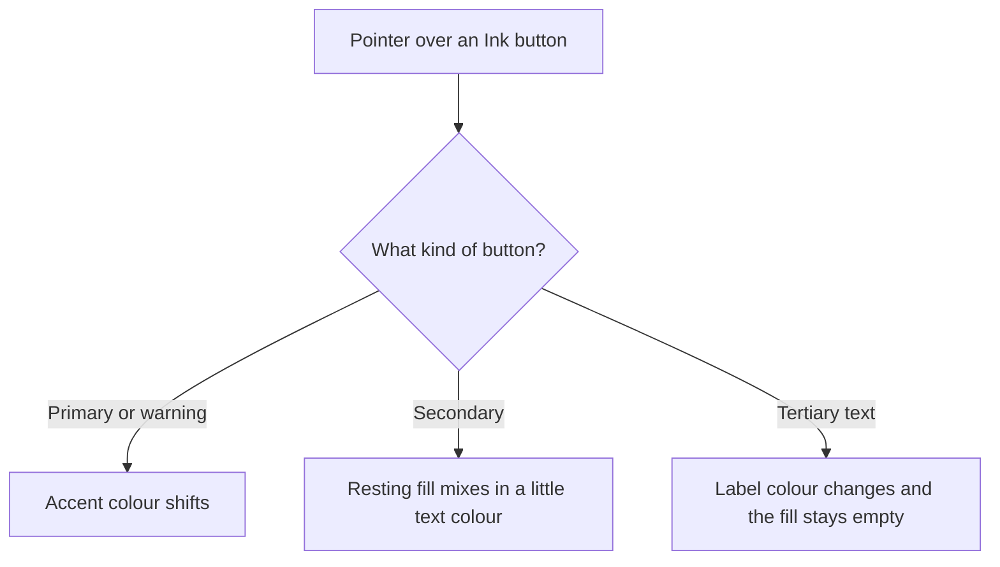

# Button hover

## Why it exists

Primary Ink buttons already change colour on hover, because they use Obsidian’s accent. On macOS, plain secondary buttons do not. Obsidian sets `--interactive-hover` to the same token as the resting fill and clears the input shadow, so a hover that only reads those tokens is invisible. Text buttons such as notice **Dismiss** must not grow a filled chip to make up for that.

---

## Conceptual understanding

Hover follows the kind of button:

- **Primary** buttons (`mod-cta`, `.ddc_ink_primary-btn`, `.ddc_ink_primary-button`) keep the accent hover they already had.
- **Secondary** buttons, including inactive segmented toggles and pending-banner buttons, pick up a darker or lighter fill. Light themes darken. Dark themes lighten.
- **Tertiary text** buttons stay unfilled. Hover changes the label colour to `--text-normal`. Notice **Dismiss** also underlines.

The change is limited to Ink surfaces: settings, dialogs, notices, embeds, and the writing and drawing editors. The rest of Obsidian is unchanged.

A selected segment of a two-way or three-way toggle stays solid accent. Its active style beats the hover fill.

---

## Technical details

`src/styles/ink-button-hover.scss` is imported from `src/main.ts`. On `body.mod-macos` it sets `--interactive-hover` to `color-mix(in srgb, var(--text-normal) 18%, var(--background-modifier-border))` inside:

| Root | What it covers |
|------|----------------|
| `.ddc_ink_settings` | Settings tab. Added in `renderSettingsTab` after the container is emptied. |
| `.modal.ddc_ink_modal` | Plugin dialogs. Each modal adds the class at the start of `onOpen`. |
| `.ddc_ink_notice` and `.notice:has(.ddc_ink_notice)` | Version and welcome notices. |
| `.ddc_ink_embed` | Embed pending banners and other embed buttons. |
| `.ddc_ink_writing-editor`, `.ddc_ink_drawing-editor` | Editor chrome. |

Custom properties inherit, so Obsidian’s `button:hover` and plugin rules that set `background-color: var(--interactive-hover)` both pick it up. Accent, warning, and rules that already use `--interactive-accent-hover` do not read `--interactive-hover`.

`--background-modifier-border-hover` is only one step from the resting border colour, so it was not used. The mix is strong enough to read next to an accent button.

Tertiary text uses `ink-tertiary-text-link-chrome` in `_ink-tertiary-text-link.scss`. Hover sets `color: var(--text-normal)` and `background: none`. Notice **Dismiss** (`.ddc_ink_tertiary-btn`) includes that mixin and adds an underline. `.ddc_ink_tertiary-button` in `support-button-set.scss` does the same colour-only hover. That class is not used from TypeScript today.

---

## Technical Gotchas

- **Do not paint a background on tertiary text hover.** Obsidian’s `button:hover` would otherwise put a rounded chip behind **Dismiss**. `background: none` on the hover rule is what stops that.
- **Do not set `--interactive-hover` on `body`.** The token is Obsidian’s. The override stays inside Ink roots so the rest of the app keeps the macOS collapse.
- **A new dialog needs `.ddc_ink_modal`.** Without that class, its plain buttons hover the macOS way: they do not. Add the class at the start of `onOpen`, next to any dialog-specific class.
- **Selected toggle segments stay accent.** Their active rule is more specific than `button:hover`. Do not let the secondary hover wash replace a selected segment.
- **High-contrast inverted primary buttons and handover secondary buttons use `!important`.** This hover token does not replace those rules.
