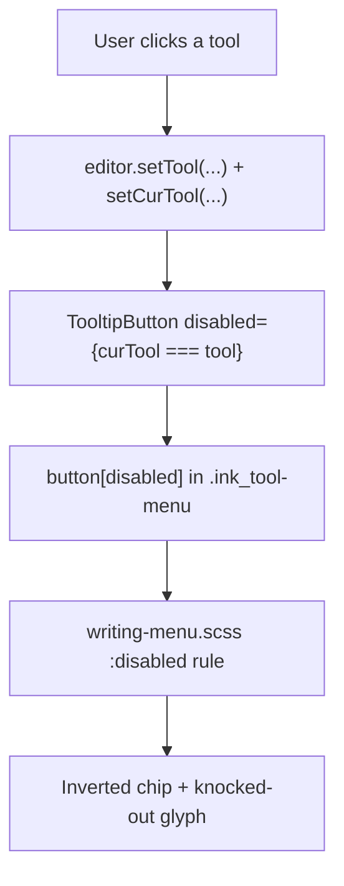
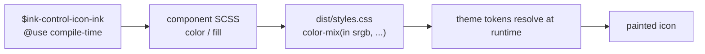

# Ink control ink and toolbar contrast

## Why it exists

Ink draws its own toolbars, menus, and floating buttons over the writing and drawing canvas. Those controls have to stay legible in **every** Obsidian theme, in both light and dark mode, without hardcoding a colour that only looks right in the default theme.

A previous version took the toolbar icon colour from `--color-base-60` and the selected-tool glyph from `--interactive-normal`. That worked in the default theme and broke in **Minimal dark**: Minimal redefines `--interactive-normal` as a 12%-alpha wash, so the glyph inside the selected tool was painted in a nearly invisible translucent grey on a solid grey disc. The tool looked like an empty light circle.

Two problems were being tangled together:

1. Unselected controls are **meant to recede**, so their ink should be deliberately soft.
2. The selected tool is **meant to be the focus**, so its ink must be full contrast.

Using one token pair for both, and picking tokens a theme is free to redefine into a low-alpha wash, produced the invisible-glyph bug.

## Conceptual understanding

### Four colour roles, not two

| Role | Meaning | Rule |
|---|---|---|
| Resting ink | Toolbar icon when idle | Soft: `--text-normal` at 50% |
| Hover ink | Pointer is over the control | Full `--text-normal` |
| Resting fill | Button surface when idle | `--interactive-normal` (a surface token, used as a surface) |
| Selected pair | Chip + glyph of the active tool | Inverted: `--text-muted` chip, `--background-primary` glyph |

The key distinction is **ink vs surface**. `--interactive-normal` is a surface token. Using it as a *glyph* colour only works when a theme happens to resolve it to a solid colour, which is exactly what Minimal does not do.

### Why the ink derives from `--text-normal`

Every theme must keep `--text-normal` legible against its own backgrounds — that is the contract of body text. Themes are **not** obliged to give the `--color-base-*` scale or `--interactive-normal` any particular value, and Minimal proves it by leaving the base scale intact while redirecting `--interactive-normal`.

So the soft ink is expressed as:

```scss
color-mix(in srgb, var(--text-normal) 50%, transparent)
```

Because it composites against the button fill rather than being a fixed grey, it tracks the theme automatically. In light mode it darkens; in dark mode it lightens.

### Why 50% is intentional, not a contrast failure

At 50% the resting icons measure roughly 3.2–3.4:1 against the button fill. That is *below* the 4.5:1 text guideline and only just above the 3.0 floor for non-text UI, and that is the point: **the resting tools are supposed to be de-emphasised** so the selected tool holds the visual weight. Do not "fix" this number upward without changing the design intent. Full contrast belongs to the selected state and to high contrast UI.

## Flows

### How a tool becomes selected



The selected tool is not styled with `.is-selected` or `aria-pressed`. It is rendered as a **disabled** button, so a `:disabled` rule is the selected state. This is easy to misread as a dimmed state — it is not.

### Colour resolution per layer



`_ink-control-ink.scss` is a compile-time Sass partial. It is `@use`d per component and inlined into the bundle, so it needs no `main.ts` import and no runtime class.

## Technical details

### The token

`src/styles/_ink-control-ink.scss`:

| Item | Value |
|---|---|
| Variable | `$ink-control-icon-ink` |
| Value | `color-mix(in srgb, var(--text-normal) 50%, transparent)` |
| Import style | `@use '...' as inkControlInk` then `inkControlInk.$ink-control-icon-ink` |
| Loaded via | Compile-time `@use` in each component SCSS (not `main.ts`) |

### Consumers

Nine files use the token for resting ink:

| File | Surface | Hover ink |
|---|---|---|
| `writing-menu.scss` | `.ink_menu-bar` buttons, quick menu, tool menu, active toggle | `--text-normal` |
| `extended-writing-menu.scss` | Extended writing menu | `--text-normal` |
| `extended-drawing-menu.scss` | Extended drawing menu (reuses `.ink_extended-writing-menu`) | `--text-normal` |
| `transition-menu.scss` | Transition menu | `--text-normal` |
| `expand-lines-button.scss` | Expand-lines button in the secondary menu bar | `--text-normal` |
| `overflow-menu.scss` | Overflow dropdown | none — the dropdown is not a hover surface |
| `resize-handle.scss` | Floating resize handle | `--text-normal` |
| `ink-transcript-view.scss` | Locked-embed display-mode toggle | accent (`--interactive-accent`) |
| `svg-edit-button.scss` | Native SVG leaf "Edit writing / Edit drawing" button | `--text-normal` |

Two do not follow the plain-hover pattern on purpose. The overflow dropdown has no hover state because it is an opened panel, and the transcript display-mode toggle is a distinct mode switch that jumps to accent on hover. Do not assume every consumer hovers to `--text-normal`.

### Selected-state pair

Both selected rules live in `writing-menu.scss`:

| Selector | State |
|---|---|
| `.ink_tool-menu button:disabled` | The currently selected tool |
| `.ink_quick-menu button.ink_menu-toggle--active` | Engaged toggle (e.g. finger drawing) |

Both use:

```scss
background-color: var(--text-muted);
color: var(--background-primary);
fill: var(--background-primary);
```

`--text-muted` maps to `--color-base-70` in Obsidian's default mapping, one step from the old `--color-base-60`, so the chip looks essentially unchanged in the default theme and in light mode. The difference is that Minimal defines `--text-muted` as a real colour, and `--background-primary` is always an opaque surface — so the glyph is genuinely knocked out rather than washed.

Measured glyph-to-chip contrast after the change:

| Theme | Ratio |
|---|---|
| Default light | 6.69 |
| Default dark | 7.95 |
| Minimal light | 5.74 |
| Minimal dark | 4.50 |

## Technical Gotchas

1. **`:disabled` in `.ink_tool-menu` means selected, not dimmed.** Do not add opacity or soft ink to it. Selection is rendered as `disabled={curTool === tool.x}`.
2. **Never use `--interactive-normal` as a glyph colour.** It is a surface token; Minimal resolves it to a 12% wash. Use it only for `background-color`.
3. **Resting 50% contrast is deliberate.** Raising it to make the numbers look better flattens the visual hierarchy between idle and selected tools.
4. **Do not hardcode black/white here.** That is the high contrast path's job. The normal path must follow theme tokens so it works on tinted and light themes.
5. **`--color-base-50` is out of scope.** It styles writing guide strokes and the canvas grid dot, not control ink.
6. **High contrast still wins.** `body.theme-dark.ddc_ink_style-for-grayscale-screen .ink_tool-menu button:disabled` is more specific than the normal rule, so the pure black/white inversion in `_style-for-grayscale-screen-controls.scss` overrides this path without `!important`. Keep it that way.
7. **`@use` paths are relative to the importing file.** A wrong depth fails the build with "Can't find stylesheet to import" — check the folder depth rather than the partial name.
8. **The transcript status icon is not interactive.** It sets its own `--text-muted` after the shared rule, so the soft token only affects the clickable display-mode toggle in that file.

## See also

- [High contrast user interface](high-contrast-user-interface.md) — the e-ink path that overrides these rules with pure black/white
- [Button hover](button-hover.md) — hover tokens and the macOS `--interactive-hover` collapse
- [Ink colours and theming](ink-colours-and-theming.md) — baked stroke colours vs themed preview (a different colour system)
