# ClickUp MCP and Cursor Setup (Cursor IDE, T3 Code, Cursor CLI, and Cloud Agents)

Obsidian Ink uses ClickUp workspace ID `36639212`. Folder and list IDs are in `.cursor/rules/clickup.mdc`. Use `36639212` wherever this page says `[CLICKUP_WORKSPACE_ID]`.

> ## MANDATORY STANDARD — IMPLEMENT RANK 1 ON EVERY MACHINE
>
> **Do not rely on interactive browser OAuth for ClickUp MCP in local Cursor / T3 Code setups, and do not hardcode plaintext API tokens in `mcp.json`.**
>
> On every development machine (**macOS, Windows, and Linux**), you **must** implement **Rank 1**:
>
> 1. Store your ClickUp personal API token (`pk_…`) in your user environment as **`CLICKUP_API_TOKEN`** and expose it to GUI applications via your OS session manager (**macOS `LaunchAgent` `launchctl setenv`**, **Windows User Environment Variables + `WSLENV`**, or **Linux `~/.config/environment.d/` + `systemctl --user`**).
> 2. Configure **`~/.cursor/mcp.json`** (or `%USERPROFILE%\.cursor\mcp.json` on Windows) to authenticate via environment-variable expansion and scope the workspace via header:
>    ```json
>    {
>      "mcpServers": {
>        "clickup": {
>          "url": "https://mcp.clickup.com/mcp",
>          "disabled": false,
>          "headers": {
>            "Authorization": "Bearer ${env:CLICKUP_API_TOKEN}",
>            "x-workspace-id": "[CLICKUP_WORKSPACE_ID]"
>          }
>        }
>      }
>    }
>    ```
>
> **Why Rank 1 is mandatory:** It is the **only** architecture that keeps `mcp.json` 100% free of plaintext secrets, spawns **zero** extra `stdio` child processes, and works **100% automatically on Turn 1** across Cursor IDE, Cursor CLI (`cursor-agent`), and T3 Code — including brand-new repositories, T3 Code git worktrees, and repo-less Scratch threads.

---

## Conceptual understanding

Agents use the official ClickUp MCP server (`https://mcp.clickup.com/mcp`) for task status transitions, PR custom-field updates, and `/build-ready-tasks`. Although Cursor IDE, T3 Code (using the Cursor provider), and Cursor Cloud Agents all run Cursor models, **they do not share MCP OAuth token storage**, and the underlying Cursor Agent SDK (`@cursor/sdk`) scopes OAuth logins per folder:

| Runtime | How it runs Cursor | Where MCP config is read | How authentication works |
|---|---|---|---|
| **Cursor IDE (local)** | Built-in Electron extension host (`anysphere.cursor-mcp`) | `~/.cursor/mcp.json` + `<repo>/.cursor/mcp.json` + IDE plugins | Reads `headers.Authorization` (`${env:CLICKUP_API_TOKEN}`) from `mcp.json` when present; otherwise falls back to IDE-only OAuth tokens in `state.vscdb` (encrypted via OS keystore) |
| **T3 Code (`cursor` provider) & Cursor CLI (`cursor-agent`)** | Official `@cursor/sdk` TypeScript package (`cursor-agent-sdk.local` runtime) | `~/.cursor/mcp.json` + `<repo>/.cursor/mcp.json` + `~/.cursor/plugins/` (when `settingSources` includes `"user"`, `"project"`, `"plugins"`) | Reads `headers.Authorization` (`${env:CLICKUP_API_TOKEN}`) from `mcp.json` (works globally across all repos, worktrees, and Scratch threads). Without `headers.Authorization`, falls back to per-folder `~/.cursor/projects/<project-slug>/mcp-auth.json` |
| **Cursor Cloud Agents** | Remote Cloud VM | [cursor.com/agents](https://cursor.com/agents) MCP dropdown / [Integrations & MCP](https://cursor.com/dashboard/integrations) | Cursor Cloud backend (per-user OAuth on dashboard) + `CLICKUP_API_TOKEN` in Cloud Agent Secrets for REST subtask reparenting |

```mermaid
flowchart TB
  subgraph OS["OS User Environment (Single Source of Truth)"]
    MacEnv["macOS: ~/.zshenv + LaunchAgent<br/>(launchctl setenv CLICKUP_API_TOKEN)"]
    WinEnv["Windows: HKCU\\Environment<br/>(User Env Var + WSLENV)"]
    LinEnv["Linux: ~/.zshenv + ~/.config/environment.d/clickup.conf<br/>(systemctl --user set-environment)"]
  end

  GlobalMcp["~/.cursor/mcp.json<br/>url: https://mcp.clickup.com/mcp<br/>Authorization: Bearer &#36;{env:CLICKUP_API_TOKEN}<br/>x-workspace-id: [CLICKUP_WORKSPACE_ID]"]
  CloudDash["cursor.com/agents MCP UI<br/>+ Cloud Secrets"]

  MacEnv --> GuiEnv["GUI Process Environment (process.env.CLICKUP_API_TOKEN)"]
  WinEnv --> GuiEnv
  LinEnv --> GuiEnv

  GuiEnv --> CursorIDE["Cursor IDE"]
  GuiEnv --> T3Code["T3 Code / @cursor/sdk<br/>(All repos, worktrees & Scratch threads)"]
  GuiEnv --> AgentShell["Agent Shell<br/>scripts/clickup-set-parent.sh"]

  GlobalMcp --> CursorIDE
  GlobalMcp --> T3Code
  CloudDash --> CloudAgent["Cursor Cloud Agent VM"]

  CursorIDE --> ClickUpMCP["https://mcp.clickup.com/mcp<br/>(67 ClickUp MCP tools)"]
  T3Code --> ClickUpMCP
  CloudAgent --> ClickUpMCP
  AgentShell --> ClickUpREST["PUT https://api.clickup.com/api/v2/task/{id}<br/>(Subtask reparenting)"]
```



### Upstream evidence: why OAuth breaks in T3 Code, CLI, and worktrees

This issue is widely reported across both the T3 Code issue tracker and the Cursor community forums, and has been confirmed by both T3 Code maintainers and Cursor staff:

- **[`pingdotgg/t3code#19552`](https://github.com/pingdotgg/t3code/issues/19552) — *"Cursor threads in T3 worktrees report OAuth MCP servers as needsAuth because tokens are stored per worktree"* (Closed as `upstream`):**
  - `@cursor/sdk` resolves `projectRoot` as the git top-level of `local.cwd` and reads OAuth tokens from `~/.cursor/projects/<slug(projectRoot)>/mcp-auth.json` with **no user-level fallback**.
  - Every new repository, every T3 Code git worktree (`~/.t3/worktrees/<repo>/t3code-<id>`), and every repo-less Scratch folder gets a brand-new `<project-slug>` directory containing only `clientInfo` (dynamic OAuth client registration) and no `tokens`.
  - Furthermore, `@cursor/sdk` (`class Kg` in `dist/esm/748.js`) caches `mcp-auth.json` in a process-wide static `Map` (`Kg.mcpAuthPromises`) on first open and never re-reads it from disk until the server restarts.
  - T3 Code maintainer `juliusmarminge` confirmed T3 Code will not symlink files inside `~/.cursor` because it is private, undocumented Cursor storage.
- **[Cursor Forum Topic #159797](https://forum.cursor.com/t/sdk-local-agents-cannot-access-http-mcps-with-oauth-from-settingsources/159797) — *"SDK local agents cannot access HTTP MCPs with OAuth from settingSources"*:**
  - Confirmed by Cursor staff (`@deanrie`): although Cursor's SDK docs claim local SDK runs reuse saved logins from the Cursor app, `@cursor/sdk` cannot read the Cursor IDE's internal OAuth store (`state.vscdb`).
- **[Cursor Forum Topic #159989](https://forum.cursor.com/t/mcp-servers-are-not-enabled-authenticated-in-new-worktree-agents-oauth-making-worktrees-impractical/159989) & [Topic #173938](https://forum.cursor.com/t/cursor-sdk-local-runtime-claude-format-hook-output-ignored-send-mcpservers-drops-file-based-mcp-servers-mcp-logins-are-per-folder/173938) — *"@cursor/sdk local runtime: MCP logins are per folder"*:**
  - Confirmed by Cursor staff (`@deanrie`, Oct 2026): `@cursor/sdk` still scopes `mcp-auth.json` per folder with no option to override the path. Cursor staff explicitly recommend **using an API key / PAT in `headers` where the MCP server supports it** rather than symlinking `mcp-auth.json` across parallel agents.
- **[`pingdotgg/t3code#15268`](https://github.com/pingdotgg/t3code/issues/15268) & [`pingdotgg/t3code#16431`](https://github.com/pingdotgg/t3code/issues/16431) — *"Cursor threads lose all user, plugin, and project MCP servers"*:**
  - Earlier `@cursor/sdk` versions (`1.0.31–1.0.36`) dropped all `~/.cursor/mcp.json` servers when `t3-code` was passed on `agent.send({ mcpServers })`. Fixed in `@cursor/sdk` `1.0.38+` (bundled in T3 Code `0.1.6+`).

---

### Comparison of all candidate options

| Option | Works in new repos, worktrees & Scratch threads on Turn 1? | Plaintext secrets in `mcp.json`? | Extra child processes per thread? | Verdict & Trade-offs |
|---|---|---|---|---|
| **Rank 1 (REQUIRED FOR CLICKUP):<br/>`"Authorization": "Bearer ${env:CLICKUP_API_TOKEN}"` + `"x-workspace-id"` in `mcp.json` + OS GUI env bridge** | **Yes (100% automatic everywhere)** | **No** (literal `${env:CLICKUP_API_TOKEN}` in `mcp.json`) | **Zero** (native HTTP) | **Best practice — MUST implement.** Recommended by Cursor staff ([Topic #159989](https://forum.cursor.com/t/mcp-servers-are-not-enabled-authenticated-in-new-worktree-agents-oauth-making-worktrees-impractical/159989)). Bypasses `mcp-auth.json` completely, uses the same `CLICKUP_API_TOKEN` already required for `/build-ready-tasks`, and survives all Cursor/T3 Code updates. |
| **Rank 2 (Fallback for OAuth-only MCPs that reject API tokens, e.g. `expo-mcp`, `Prisma`):<br/>`npx -y mcp-remote <url>` (`stdio` bridge)** | **Yes (100% automatic everywhere)** | **No** (stores OAuth token once per user in `~/.mcp-auth/`) | **Yes — 1 Node process per active thread** (~40 MB RAM + 1–2s startup latency) | Recommended by ClickUp's docs for clients without working HTTP OAuth. Do **not** use for ClickUp in Cursor/T3 Code because Rank 1 avoids the per-thread `stdio` process bloat. Use only for third-party MCPs that strictly forbid API token headers. |
| **Rank 3 (Not recommended as primary):<br/>Symlinking `~/.cursor/projects/*/mcp-auth.json` → `~/.cursor/mcp-auth.json`** | **No — fails on Turn 1 of any brand-new repo, worktree, or Scratch folder** | **No** | **Zero** | Relies on undocumented `@cursor/sdk` internals (`~/.cursor/projects/<slug>/mcp-auth.json`) and its in-memory `Kg.mcpAuthPromises` cache. Unsafe for OAuth servers that rotate single-use refresh tokens (like Atlassian). Acceptable only as a secondary backup alongside Rank 1. |
| **Rank 4 (Do not use):<br/>In-process preload patching of `@cursor/sdk` inside `app.asar`** | **Yes** | **No** | **Zero** | Used by some Linux self-builders ([Topic #173938](https://forum.cursor.com/t/cursor-sdk-local-runtime-claude-format-hook-output-ignored-send-mcpservers-drops-file-based-mcp-servers-mcp-logins-are-per-folder/173938)), but breaks macOS/Windows code-signing on packaged T3 Code desktop builds and is wiped on every T3 Code update. |

---

### Chronological log of what was tried, what failed, and why

1. **Attempt 1: Relying on Cursor IDE's existing ClickUp OAuth login (Failed)**
   - **What was tried:** Verified ClickUp was connected with 67 tools in Cursor IDE (`Settings → Tools & MCP`), then started a T3 Code thread using the Cursor provider.
   - **What happened:** `clickup` was missing from the T3 Code thread's MCP namespaces.
   - **Why:** Cursor IDE writes OAuth tokens to `~/Library/Application Support/Cursor/User/globalStorage/state.vscdb` (`mcpOAuth.secret.*`). T3 Code uses `@cursor/sdk`, which only reads `~/.cursor/projects/<project-slug>/mcp-auth.json`. Because `mcp-auth.json` had no `tokens`, `https://mcp.clickup.com/mcp` returned `HTTP 401` and `@cursor/sdk` silently dropped the server.

2. **Attempt 2: Running `cursor-agent mcp login clickup` inside an agent tool shell (Failed)**
   - **What was tried:** Ran `~/.local/bin/cursor-agent mcp login clickup` inside an agent shell tool call so the user could click **Connect** in the browser.
   - **What happened:** Clicking **Connect** in the browser failed with `ERR_CONNECTION_REFUSED` (`This site can't be reached` at `http://localhost:8787/callback`).
   - **Why:** `cursor-agent mcp login` binds a temporary HTTP server on `127.0.0.1:8787`. When an agent shell tool call returns, the harness terminates the child process group, killing the listener on port `8787` before the user clicks **Connect** in the browser.

3. **Attempt 3: Symlinking `~/.cursor/projects/*/mcp-auth.json` → `~/.cursor/mcp-auth.json` (Worked for pre-existing repos after restart, failed for new repos, worktrees, and Scratch threads)**
   - **What was tried:** Ran a persistent OAuth PKCE callback listener on `127.0.0.1:8787` under `launchctl`, exchanged the code at `https://mcp.clickup.com/oauth/token` (`expires_in: 315360000` / 10 years, `scope: read write`), saved `~/.cursor/mcp-auth.json` for both `clickup` and `plugin-clickup-clickup`, and symlinked all existing `~/.cursor/projects/*/mcp-auth.json` files to it.
   - **What happened:**
     - Failed in projects that were already open in T3 Code before OAuth completed because `class Kg` in `@cursor/sdk` caches `mcp-auth.json` in a static `Map` (`Kg.mcpAuthPromises`) on first read and never re-reads disk until T3 Code restarts.
     - Worked in existing repos after a T3 Code restart, but **failed on Turn 1 of any brand-new repo, new git worktree, or repo-less Scratch thread** because those new `<project-slug>` folders do not exist yet when `@cursor/sdk` starts.

4. **Attempt 4: Hardcoding a literal `Bearer pk_…` token in `~/.cursor/mcp.json` without `x-workspace-id` (Failed tool calls)**
   - **What was tried:** Passed `"Authorization": "Bearer pk_…"` in `~/.cursor/mcp.json` with no other headers.
   - **What happened:** All 67 ClickUp tools loaded, but calling any tool (`clickup_get_user`, `clickup_get_workspace_hierarchy`) failed with:
     `Please specify which workspace to use by providing the 'workspace_id' parameter or by setting the 'x-workspace-id' header.`
   - **Why:** Interactive OAuth tokens embed the selected workspace ID during browser consent, whereas a ClickUp personal API token (`pk_…`) spans the user's entire account and requires `"x-workspace-id": "[CLICKUP_WORKSPACE_ID]"` in `headers`.

5. **Attempt 5: Using `"Authorization": "Bearer ${env:CLICKUP_API_TOKEN}"` in `~/.cursor/mcp.json` with `~/.zshenv` only (Failed in GUI-launched T3 Code)**
   - **What was tried:** Replaced the literal token in `~/.cursor/mcp.json` with `"Bearer ${env:CLICKUP_API_TOKEN}"` while `CLICKUP_API_TOKEN` was only exported in `~/.zshenv`.
   - **What happened:** Failed in T3 Code Desktop when launched from the macOS Dock/Finder.
   - **Why:** T3 Code Desktop's `DesktopShellEnvironment.ts` login-shell probe only extracts a hardcoded allowlist (`LOGIN_SHELL_ENV_NAMES`: `PATH`, `LANG`, `HOMEBREW_*`, `SSH_AUTH_SOCK`, etc.) and ignores custom variables like `CLICKUP_API_TOKEN`. When `process.env.CLICKUP_API_TOKEN` is `undefined`, `@cursor/sdk`'s `Jm()` regex (`dist/esm/748.js`) leaves the literal string `"${env:CLICKUP_API_TOKEN}"` unexpanded, causing `401`.

6. **Attempt 6 (Rank 1 — Succeeded everywhere): `"Authorization": "Bearer ${env:CLICKUP_API_TOKEN}"` + `"x-workspace-id"` in `mcp.json` + OS GUI environment bridge**
   - **What was done:** Configured the OS session manager (`launchctl setenv` via `LaunchAgent` on macOS) so GUI apps inherit `CLICKUP_API_TOKEN` in `process.env`, and set `"Authorization": "Bearer ${env:CLICKUP_API_TOKEN}"` + `"x-workspace-id": "[CLICKUP_WORKSPACE_ID]"` in `~/.cursor/mcp.json`.
   - **Verified end-to-end (with all `mcp-auth.json` symlinks removed):**
     - Brand-new git repository (`/tmp/t3-rank1-test-repo`) → **Passed on Turn 1**
     - Brand-new T3 Code git worktree (`--worktree HEAD --branch feat/worktree-test`) → **Passed on Turn 1**
     - Brand-new non-git folder (`/tmp/t3-rank1-norepo`) → **Passed on Turn 1**

---

## Technical details

### Step-by-step implementation guide (macOS, Windows, and Linux)

Follow the steps below for your operating system. Every step is required so that Cursor IDE, `cursor-agent` CLI, T3 Code (all repos, worktrees, and Scratch threads), and `scripts/clickup-set-parent.sh` all work from a single token with zero secrets in `mcp.json`.

---

#### Step 1 (All OSes): Verify Cursor CLI, Node.js, and ClickUp token prerequisites

1. **Cursor CLI (`cursor-agent` / `agent`):** Confirm it is installed and on `PATH`:
   ```bash
   cursor-agent --version
   ```
   *(If not installed, install from [cursor.com/cli](https://cursor.com/cli) or Cursor IDE command palette → `Install 'cursor-agent' command`.)*
2. **Node.js `22.13+`:** Required by `@cursor/sdk`:
   ```bash
   node -v
   ```
3. **T3 Code Cursor Provider:** Open T3 Code → **Settings → Providers → Cursor**, ensure it is enabled, and sign in.
4. **ClickUp Personal API Token (`pk_…`):** Create or copy your token from [ClickUp Settings → Apps](https://app.clickup.com/settings/apps) → **API Token**.
5. **Find your numeric `[CLICKUP_WORKSPACE_ID]`:**
   - Either copy the first number in your ClickUp URL (`https://app.clickup.com/<workspace_id>/...`), or query the ClickUp API:
     ```bash
     curl -s -H "Authorization: pk_…" https://api.clickup.com/api/v2/team \
       | python3 -c "import json,sys; [print(t['id'], '|', t['name']) for t in json.load(sys.stdin).get('teams',[])]"
     ```

---

#### Step 2: Configure the OS environment bridge (Pick your OS)

Because `DesktopShellEnvironment.ts` in T3 Code only probes `PATH` and locale variables from login shells, you must set `CLICKUP_API_TOKEN` in **both** your shell startup file (for CLI / Agent Shell scripts like `scripts/clickup-set-parent.sh`) **and** your OS GUI session manager (so Dock / Start Menu / desktop-launched T3 Code and Cursor IDE inherit `process.env.CLICKUP_API_TOKEN`).

##### Option 2A — macOS (`darwin`)

1. **Add `CLICKUP_API_TOKEN` to `~/.zshenv`** (read by all `zsh` shells, including Agent Shell):
   ```zsh
   # In ~/.zshenv
   export CLICKUP_API_TOKEN='pk_…'
   ```
2. **Create and load `~/Library/LaunchAgents/com.user.clickup-env.plist`** so macOS `launchd` automatically reads `~/.zshenv` on login and exposes `CLICKUP_API_TOKEN` to all GUI apps (T3 Code and Cursor IDE):
   ```bash
   mkdir -p ~/Library/LaunchAgents
   cat <<'EOF' > ~/Library/LaunchAgents/com.user.clickup-env.plist
   <?xml version="1.0" encoding="UTF-8"?>
   <!DOCTYPE plist PUBLIC "-//Apple//DTD PLIST 1.0//EN" "http://www.apple.com/DTDs/PropertyList-1.0.dtd">
   <plist version="1.0">
   <dict>
     <key>Label</key>
     <string>com.user.clickup-env</string>
     <key>ProgramArguments</key>
     <array>
       <string>/bin/zsh</string>
       <string>-c</string>
       <string>source "$HOME/.zshenv" 2>/dev/null; if [ -n "${CLICKUP_API_TOKEN:-}" ]; then /bin/launchctl setenv CLICKUP_API_TOKEN "$CLICKUP_API_TOKEN"; fi</string>
     </array>
     <key>RunAtLoad</key>
     <true/>
   </dict>
   </plist>
   EOF

   plutil -lint ~/Library/LaunchAgents/com.user.clickup-env.plist
   launchctl bootout gui/$(id -u)/com.user.clickup-env 2>/dev/null || true
   launchctl bootstrap gui/$(id -u) ~/Library/LaunchAgents/com.user.clickup-env.plist
   launchctl kickstart -kp gui/$(id -u)/com.user.clickup-env
   ```
3. **Verify `launchd` has the token** (must print a non-zero character count, e.g. `45`):
   ```bash
   launchctl getenv CLICKUP_API_TOKEN | wc -c
   ```

##### Option 2B — Windows (`win32`, Native & WSL)

On Windows, GUI applications (T3 Code Desktop and Cursor IDE) and terminal shells (PowerShell, CMD, Git Bash) automatically inherit **Windows User Environment Variables** (`HKCU\Environment`) at process start. T3 Code's `installWindowsEnvironment` keeps all Windows User Environment Variables on `process.env` intact.

1. **Open PowerShell and set `CLICKUP_API_TOKEN` as a persistent Windows User Environment Variable** (and add it to `WSLENV` so T3 Code's `mergeWslEnv` also forwards it automatically if you enable the WSL backend in T3 Code):
   ```powershell
   # 1. Set CLICKUP_API_TOKEN in HKCU\Environment (persists across reboots for all GUI apps & shells)
   [Environment]::SetEnvironmentVariable('CLICKUP_API_TOKEN', 'pk_…', 'User')

   # 2. Forward CLICKUP_API_TOKEN into WSL automatically (safe even if you do not use WSL)
   $currentWslEnv = [Environment]::GetEnvironmentVariable('WSLENV', 'User')
   $entries = @($currentWslEnv -split ':' | Where-Object { $_ -and $_ -notmatch '^CLICKUP_API_TOKEN(/|$)' })
   [Environment]::SetEnvironmentVariable('WSLENV', (($entries + 'CLICKUP_API_TOKEN') -join ':'), 'User')
   ```
2. **If you also use WSL or Git Bash on Windows**, add a fallback export to `~/.zshenv` and `~/.bashrc` inside that environment (or let `WSLENV` forward it from Windows):
   ```bash
   export CLICKUP_API_TOKEN="${CLICKUP_API_TOKEN:-pk_…}"
   ```
3. **Verify in a new PowerShell window** (must print `True`):
   ```powershell
   [bool]([Environment]::GetEnvironmentVariable('CLICKUP_API_TOKEN', 'User'))
   ```

##### Option 2C — Linux (`linux`)

On Linux, T3 Code Desktop's `installPosixEnvironment` only extracts `LOGIN_SHELL_ENV_NAMES` (`PATH`, `DBUS_SESSION_BUS_ADDRESS`, `DISPLAY`, `XDG_*`, etc.) from your login shell, so desktop-launched GUI apps must receive `CLICKUP_API_TOKEN` from the **systemd user / desktop session environment** (`~/.config/environment.d/`), while shells read `~/.zshenv` and `~/.profile`.

1. **Add `CLICKUP_API_TOKEN` to `~/.zshenv` and `~/.profile`** (for `zsh` and `bash`/`sh` shells):
   ```bash
   grep -q 'CLICKUP_API_TOKEN' ~/.zshenv 2>/dev/null || echo "export CLICKUP_API_TOKEN='pk_…'" >> ~/.zshenv
   grep -q 'CLICKUP_API_TOKEN' ~/.profile 2>/dev/null || echo "export CLICKUP_API_TOKEN='pk_…'" >> ~/.profile
   chmod 600 ~/.zshenv ~/.profile 2>/dev/null || true
   ```
2. **Create `~/.config/environment.d/clickup.conf` and push it into the live systemd / D-Bus user session** (so GUI apps launched from your desktop launcher inherit `CLICKUP_API_TOKEN` immediately and on every future login):
   ```bash
   mkdir -p ~/.config/environment.d
   cat <<'EOF' > ~/.config/environment.d/clickup.conf
   CLICKUP_API_TOKEN=pk_…
   EOF
   chmod 600 ~/.config/environment.d/clickup.conf

   # Apply immediately to the running desktop session without logging out:
   source ~/.zshenv
   systemctl --user set-environment CLICKUP_API_TOKEN="$CLICKUP_API_TOKEN"
   dbus-update-activation-environment --systemd CLICKUP_API_TOKEN 2>/dev/null || true
   ```
3. **Verify the systemd user manager has the variable** (must print `set`):
   ```bash
   systemctl --user show-environment | grep -q '^CLICKUP_API_TOKEN=.' && echo set
   ```

---

#### Step 3 (All OSes): Configure `~/.cursor/mcp.json` (Zero plaintext secrets)

Edit your global Cursor MCP file:
- **macOS / Linux:** `~/.cursor/mcp.json`
- **Windows:** `%USERPROFILE%\.cursor\mcp.json` (and `~/.cursor/mcp.json` inside WSL if using T3 Code's WSL backend)

Add or merge the `clickup` server entry below, replacing `[CLICKUP_WORKSPACE_ID]` with your numeric ClickUp Workspace ID from Step 1. **Keep `${env:CLICKUP_API_TOKEN}` literally as written** — `@cursor/sdk` and Cursor IDE expand `${env:CLICKUP_API_TOKEN}` in memory from `process.env`:

```json
{
  "mcpServers": {
    "clickup": {
      "url": "https://mcp.clickup.com/mcp",
      "disabled": false,
      "headers": {
        "Authorization": "Bearer ${env:CLICKUP_API_TOKEN}",
        "x-workspace-id": "[CLICKUP_WORKSPACE_ID]"
      }
    }
  }
}
```

---

#### Step 4 (All OSes): Restart T3 Code & Cursor IDE, then verify

1. **Fully quit and relaunch T3 Code** (`Cmd+Q` on macOS, or **Quit** from the system tray / taskbar on Windows and Linux) and **Cursor IDE**.
   - *Why:* An already-running T3 Code server process has the old `process.env` snapshot from before Step 2 and caches `mcp.json` in memory (`class Hg`) for the life of the server process.
2. **Verify in T3 Code:**
   - Open any project (or a brand-new git worktree or Scratch thread) using the **Cursor** provider.
   - Ask the agent: *"Call `clickup_get_user` via the `clickup` MCP and report my email. Do not use the shell."*
   - Confirm it calls `clickup` → `clickup_get_user` and returns your ClickUp user details.

---

### Enabling cross-machine agent links in T3 Code (`t3_environment_links`)

Adding a second computer (such as `[REMOTE_HOSTNAME]`) under **Settings → Environments** connects the T3 Code **desktop UI** to that machine, but does **not** expose that machine to agents via the `t3-code` MCP server (`t3_environment_links`, `t3_environment_link`).

To allow agents on one machine to delegate or start threads on another machine:

1. Enable the beta setting **`linkedEnvironmentsEnabled`: `true`** in `~/.t3/userdata/settings.json` (`%USERPROFILE%\.t3\userdata\settings.json` on Windows), or toggle **Settings → Labs → Linked environments** in the T3 Code UI, on **both** machines.
2. Open **Settings → Sharing & access (Connections) → Linked environments** and click **Link environment** to pair the two machines.
3. Once enabled, new threads automatically see `t3_environment_links`, `t3_environment_link`, and `t3_environment_unlink` in the `t3-code` MCP namespace.

---

### Reparenting tasks as subtasks (`/build-ready-tasks`)

Official ClickUp MCP can **create** a new task as a subtask (`clickup_create_task` + `parent`), but it **cannot** convert an existing task into a subtask (`clickup_update_task` has no `parent` field and strips extra arguments).

ClickUp’s REST [Update Task](https://developer.clickup.com/reference/updatetask) API supports `"parent": "<parent_task_id>"` on an existing task while preserving its ID and history. `/build-ready-tasks` uses the `CLICKUP_API_TOKEN` configured in Step 2 to make that REST call via `scripts/clickup-set-parent.sh`:

```bash
scripts/clickup-set-parent.sh <task_id> <parent_task_id>
```

For **Cursor Cloud Agents**, also add `CLICKUP_API_TOKEN` in [Cursor dashboard Secrets](https://cursor.com/dashboard/cloud-agents).

#### If nesting stops working — tell the user this

Agents should not guess a new secret location. **Do not create (or keep) a grouping parent.** Fall back to the original tickets (each In Progress, then each Review with the PR URL) and walk the user through this checklist:

1. **Confirm `CLICKUP_API_TOKEN` is set in the OS environment (Step 2):**
   - **macOS:** Confirm `export CLICKUP_API_TOKEN='pk_…'` is in `~/.zshenv` and run `launchctl kickstart -kp gui/$(id -u)/com.user.clickup-env`.
   - **Windows:** Confirm `[Environment]::GetEnvironmentVariable('CLICKUP_API_TOKEN', 'User')` is non-empty in PowerShell.
   - **Linux:** Confirm `export CLICKUP_API_TOKEN='pk_…'` is in `~/.zshenv` / `~/.profile` and `~/.config/environment.d/clickup.conf`, then run `systemctl --user set-environment CLICKUP_API_TOKEN="$CLICKUP_API_TOKEN"`.
2. **Start a new Agent chat / shell** (or run `source ~/.zshenv` on macOS/Linux) before testing `test -n "${CLICKUP_API_TOKEN:-}" && echo set`.
3. **Do not** use [Cloud Agent Secrets](https://cursor.com/dashboard/cloud-agents) for local chats — that tab only reaches Cloud Agent VMs.
4. If the token is set but REST returns **401/403**, regenerate the `pk_…` token in ClickUp Apps, update your Step 2 config, and restart T3 Code / Cursor.
5. If REST returns **200** but `clickup_get_task` still shows `parent: null`, delete any unused wrapper and fall back to the original tickets.

---

### Enable ClickUp for Cursor Cloud Agents

**Cursor Cloud MCP ≠ ClickUp.** On [cursor.com/agents](https://cursor.com/agents), the MCP section shows **Cursor Cloud MCP** (Cursor’s built-in diagnostics tools). You must add ClickUp as a separate custom MCP:

1. Open [cursor.com/agents](https://cursor.com/agents) → **MCP**.
2. Add a **custom** MCP named `clickup` with HTTP URL `https://mcp.clickup.com/mcp`.
3. Click **Add**, then open the dropdown again to select `clickup` (newly added custom MCPs appear in the dropdown on the second pass).
4. Complete the **Login / Connect** OAuth prompt in the dashboard.

---

## Technical Gotchas

- **Why the OS GUI environment bridge (Step 2) is mandatory for `${env:CLICKUP_API_TOKEN}`:**
  - On **macOS** and **Linux**, T3 Code Desktop's `DesktopShellEnvironment.ts` (`installPosixEnvironment`) only extracts `LOGIN_SHELL_ENV_NAMES` (`PATH`, `DBUS_SESSION_BUS_ADDRESS`, `DISPLAY`, `LANG`, `LC_*`, `SSH_AUTH_SOCK`, `HOMEBREW_*`, `XDG_*`, `WAYLAND_DISPLAY`, `SSL_CERT_*`, `NODE_EXTRA_CA_CERTS`, `__MISE_DIFF`) from your login shell and ignores custom variables like `CLICKUP_API_TOKEN`.
  - On **Windows**, `installWindowsEnvironment` only probes `PATH`, `FNM_DIR`, and `FNM_MULTISHELL_PATH` from PowerShell profiles, relying on Windows User Environment Variables (`HKCU\Environment`) for everything else in `process.env`.
  - When `@cursor/sdk` (`function Km` / `Jm` in `dist/esm/748.js`) parses `mcp.json`, it expands `${env:VAR}` using `process.env[VAR]`. If `process.env.CLICKUP_API_TOKEN` is `undefined`, `@cursor/sdk` leaves the literal string `"${env:CLICKUP_API_TOKEN}"` in the `Authorization` header, which ClickUp rejects with `HTTP 401`.
- **`x-workspace-id` header is mandatory when authenticating via `Bearer` token:** Interactive browser OAuth embeds the chosen workspace ID inside the OAuth token, whereas a ClickUp personal API token (`pk_…`) is account-wide. Without `"x-workspace-id": "[CLICKUP_WORKSPACE_ID]"` in `headers`, every ClickUp MCP tool call fails with `Please specify which workspace to use by providing the 'workspace_id' parameter or by setting the 'x-workspace-id' header`.
- **`@cursor/sdk` caches `mcp.json` (`class Hg`) per project for the life of the T3 Code server process:** Whenever you edit `mcp.json` or rotate `CLICKUP_API_TOKEN`, you must quit and reopen T3 Code so the backend server process restarts with the updated environment and reloads `mcp.json`.
- **What to do for other OAuth-only MCP servers that do not support API tokens (e.g. `expo-mcp`, `Prisma`):** If another HTTP MCP server strictly requires OAuth and rejects `Authorization: Bearer` API keys, use **Rank 2** for that server: wrap it with `"command": "npx", "args": ["-y", "mcp-remote", "<url>"]` in `mcp.json` so `mcp-remote` stores the OAuth token once per user in `~/.mcp-auth/` instead of per-folder in `~/.cursor/projects/<slug>/mcp-auth.json`.
- **`@cursor/sdk` ignores `"disabled": true` in `mcp.json`:** The SDK's Zod schema (`Gm` in `dist/esm/748.js`) strips the `disabled` field from `mcp.json` and instead checks `~/.cursor/projects/<project-slug>/mcp-disabled.json` (a JSON array of disabled server names). Any `stdio` server left in `~/.cursor/mcp.json` with `"disabled": true` will still be spawned by T3 Code in every thread unless removed from `mcp.json` or listed in `mcp-disabled.json`.

Canonical copy of this page: `_reference_ide-setup/shared/docs/cursor-mcp-clickup-cloud-agents.md`. Target projects receive `docs/cursor-mcp-clickup-cloud-agents.md` via `/update-agent-tooling`.
