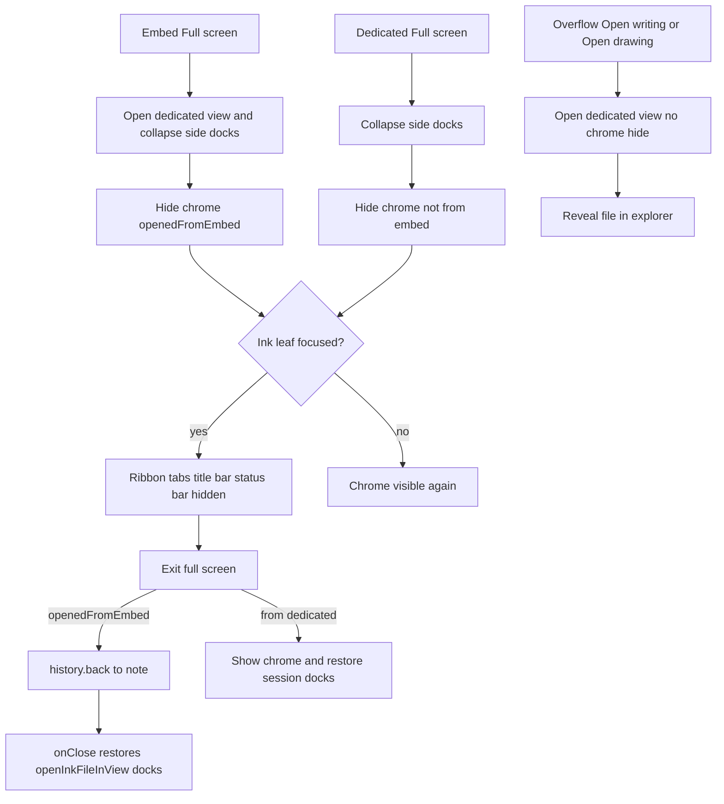

# Dedicated view full screen

## Why it exists

Opening an ink file in a dedicated view still leaves Obsidian's ribbon, tab strip, leaf title bar, and status bar on screen. Those bars take space the canvas could use. Full screen hides that chrome for the active ink leaf. Exit full screen either returns to the note (when the session started from an embed) or restores the dedicated view's chrome and side docks (when it started from a dedicated view). Locate reveals the ink file in the file explorer without entering full screen.

## Conceptual understanding

Full screen is a session on one workspace leaf. It is not a separate view type, and it is not Obsidian's own window full screen.

Two ways into full screen:

- **From an embed.** The embed's Full screen control opens the dedicated view, collapses the side docks, and hides workspace chrome. The session remembers that origin so Exit full screen can return to the note.
- **From a dedicated view that is already open.** Full screen collapses the side docks and hides workspace chrome. Locate sits to the right of Full screen until chrome is hidden.

There is no floating Back control. Exit full screen owns both origins:

- **Opened from an embed.** Exit runs the leaf history `back()` — the same action the hidden title-bar back button used to provide — which returns to the note. Closing the ink view restores the side docks that `openInkFileInView` collapsed.
- **Opened from a dedicated view.** Exit shows chrome again and restores the side-dock snapshot this session captured.

Overflow **Open writing** / **Open drawing** is a different path: it opens the dedicated view **without** full screen, then runs Locate immediately.

Switching to another leaf shows chrome again immediately; focusing the ink leaf hides it again. The session stays on that leaf until exit or close.

## Flows

### Embed Full screen

1. The embed calls `requestInkWorkspaceChromeForNextDedicatedView`, then `openInkFileInView` (side docks collapse).
2. Before the first React render, the view calls `applyPendingInkWorkspaceChromeHide` with `openedFromEmbed: true`. Chrome is already hidden when the canvas appears.
3. The menu shows Exit full screen (no Back, no Locate).
4. Exit runs `leaf.history.back()` when history exists, which returns to the note and closes the ink view. `onClose` then drops the chrome session and `restoreSidebarsAfterInkView` puts the docks back. If history is empty, Exit only shows chrome again.

If the dedicated view never opens, the embed cancels the pending request so the next unrelated ink leaf does not inherit it.

### Dedicated view Full screen

1. Full screen calls `enterInkWorkspaceChromeHidden` with sidebar collapse and `openedFromEmbed: false`.
2. The menu replaces Full screen and Locate with Exit full screen only.
3. Exit restores the side-dock state captured at the start of this session, then shows chrome.

A later save calls `setViewData` again on the same leaf. That must not start a second session or clear the one already running. The pending flag is only for the next open, and it is consumed once.

### Locate

Shown only on a dedicated view that is **not** in full screen, immediately to the right of Full screen. Tooltip is "Locate". It expands the left dock if closed, focuses the file-explorer leaf, and calls unofficial `revealInFolder` on the current ink file.

Embeds do not show Locate. Overflow Open writing / Open drawing uses the same helper after opening the dedicated view.

### Overflow Open writing / Open drawing

Locked and unlocked Live Preview overflow menus, and reading-mode overflow, call `openInkFileInViewAndLocate`: dedicated view with chrome still visible, no pending full-screen request, side docks not collapsed by the open, then Locate. The Full screen button still uses `enterFullScreen: true`.

## Technical details

Session state lives in `src/logic/utils/ink-workspace-chrome.ts`, outside React, because the body class has to be set before the editor's first render and has to survive `setViewData` replacing the React root. The origin flag is `openedFromEmbed` (`wasInkWorkspaceOpenedFromEmbed`). Exit behaviour is in `useDedicatedInkWorkspaceChrome`.

The hidden class is `ddc_ink_hide-workspace-chrome` on `document.body`. `src/styles/ink-workspace-chrome.scss` sets `display: none` on:

- `.workspace-ribbon`
- `.workspace-tab-header-container`
- `.view-header`
- `.status-bar`

`display: none` is required. Obsidian's own rules set `display: flex` on the ribbon and the view header, so a lower-specificity hide does not win. The status bar is `position: fixed`; removing it from layout is what stops it covering the canvas.

The class is applied only while `workspace.activeLeaf` is the leaf that owns the session (`active-leaf-change`). Unloading the plugin calls `releaseInkWorkspaceChromeOnPluginUnload`.

Writing and drawing both use `InkCanvasDrawingMenu`. Menu order in the left quick menu, when each control applies:

- Embed: Full screen, then the finger-drawing toggle
- Dedicated, not full screen: Full screen, Locate, then the finger-drawing toggle
- Full screen: Exit full screen, then the finger-drawing toggle

Tooltips are "Full screen", "Locate", and "Exit full screen". `WritingMenu` is not this path.

Full screen / Exit icons are Material Symbols Rounded `expand_content` / `collapse_content`, rotated 90° counterclockwise around the 960-grid centre (`rotate(-90 480 -480)`) so the L-brackets open vertically. Locate is Lucide `locate`.

While chrome is hidden, drawing's left-hand `.ink_tool-menu { left: 0 }` is overridden so tools stay centred like writing and do not sit on Exit.

`openInkFileInView` collapses side docks by default. Overflow locate passes `{ collapseSidebars: false }` so Locate can open the explorer instead of fighting a collapse.

### macOS traffic lights

Hiding the tab strip pulls the ink menu into the title-bar row. On macOS the window traffic lights cover the left of that row. While chrome is hidden and the window is not in native full screen (`body.is-fullscreen`), `.ink_quick-menu` gets a left margin of two button widths plus the 8px gap:

`calc(2 * 2.5 * var(--font-ui-small) + 8px)`

That offset is the **lights' footprint**, not how many quick-menu buttons are visible. Shrinking it after Back was removed put Exit under the green light.

Quick-menu buttons are `2.5em` and Obsidian buttons use `--font-ui-small`. Native full screen already hides the traffic lights, so the inset does not apply then. `--frame-left-space` is not used: it subtracts `--ribbon-width`, and that variable stays set after the ribbon is `display: none`.

## Technical Gotchas

- **Side docks have two owners.** Embed Full screen collapses them via `openInkFileInView` and restores them when no ink leaves remain (`restoreSidebarsAfterInkView`). Full screen from an already-open dedicated view captures its own snapshot and restores only that snapshot on exit. Mixing them would pop the docks back while the user is still in the dedicated view, or leave them collapsed after exit. Overflow Open writing / Open drawing must not use that embed collapse, or Locate would reopen a dock this session just hid.
- **React unmount is not exit.** `setViewData` unmounts the editor root on every save. Exiting chrome from that unmount would flash the ribbon back on each stroke save. Exit runs from the menu and from the view's `onClose`.
- **One session, one leaf.** Entering full screen on a different leaf restores the previous leaf's side-dock snapshot first. `exitInkWorkspaceChromeHidden` ignores a leaf id that does not own the session.
- **Pending hide is one-shot.** It is consumed by the next dedicated view's first `setViewData`. A failed full-screen open must cancel it. Overflow locate must not set the pending flag.
- **File explorer is unofficial.** Locate uses `getLeavesOfType('file-explorer')` and `revealInFolder`. If the core plugin is off, Locate is a no-op after expanding the left split.
- **jsdom does not resolve the macOS `calc()`.** Tests assert the stylesheet rule text, not the computed `margin-left`.
