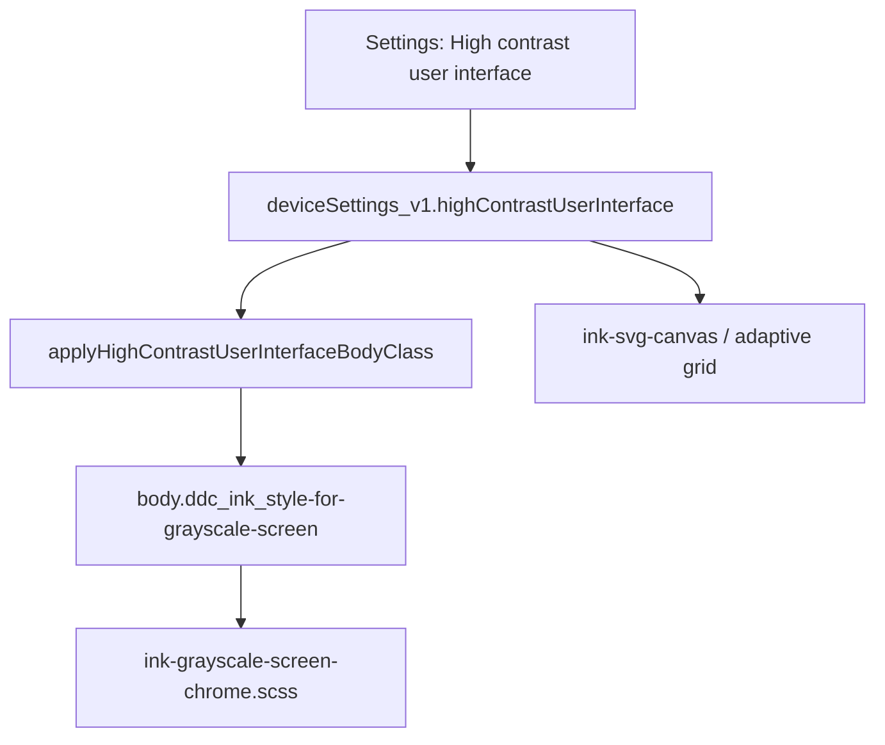

# High contrast user interface

## Why it exists

E-ink and other grayscale screens wash out Obsidian’s usual mid-gray chrome: faint borders, drop shadows, and selected-tool fills that disappear against a dark canvas. **High contrast user interface** is a device-local toggle that restyles **Ink-owned** UI (embeds, editors, toolbars, Ink notices) so controls and canvases stay readable on those displays.

It is **not** the Boox companion connection. Companion layout (embed radius, overflow clip, expand-lines, Bridge overlay) stays on `booxConnectionEnabled`. High-contrast colour and rings can run on any device, including desktop, without enabling Boox.

## Conceptual understanding

Turning the setting on adds `body.ddc_ink_style-for-grayscale-screen` (legacy class name; keep it so existing CSS and tests stay stable). Global SCSS then paints stronger rings, extreme canvas fill, and notice colours. Turning it off removes the class; Ink returns to normal theme chrome.

Scope is **plugin-owned surfaces only**: writing/drawing embeds and dedicated editors, Ink toolbars and overflow menus, pending-transcription banners, and `.notice` panels that wrap `.ddc_ink_notice`. Obsidian’s own sidebar, settings, and ribbon are left alone. Eraser pending-stroke **blur** is left as-is (`ink-svg-canvas.scss`) — high contrast must not flatten that preview.

### Layout must not move

High-contrast styling is written so **geometry stays identical** to the non-high-contrast UI: same box size, padding, and position — **not even a 1px shift**. Contrast is added by colour, by `outline` (outside the layout box), and by removing drop shadows. Do **not** thicken an existing `border` to get a heavier ring.

That constraint is why:

| Surface | How extra contrast is applied without growing the box |
|---|---|
| Editors / embeds | `outline: 2px` on the editor root (outline does not change layout). Canvas fill is clipped with the same `border-radius` as the embed, not extra padding. |
| Ink notices | Keep the original **1px** `border`. Add a **1px** `outline` for a second ring. Drop the outer `box-shadow`. Do not use a 2px border. |
| Notice primary buttons | Recolour only. Do not add outline, extra border, or padding. |
| Selected vs idle toolbar tools | Same **2px** `--text-normal` ring in both states. Selected state is inverted fill, not a thicker ring (a same-colour ring on a dark canvas looks like a smaller button). |
| Drop shadows | `box-shadow: none` on Ink chrome. Shadows never participate in layout; removing them must not be compensated with extra border width. |

If a future visual tweak needs a heavier edge, prefer `outline` or an inset `box-shadow` with **0 blur and 0 spread change to the border-box**, never `border-width` increases on a control that already has a border.

## Flows

### Toggle on this device

1. **Settings → Ink → High contrast user interface** (below **Dominant hand**) writes `highContrastUserInterface` via `setHighContrastUserInterface` (localStorage blob, not `data.json`).
2. The settings `onChange` also calls `applyHighContrastUserInterfaceBodyClass` immediately so the class updates without waiting for another event.
3. `main.ts` applies the class on plugin load and subscribes to device-settings changes (same-tab custom event and cross-tab `storage`) so other windows stay in sync.
4. Plugin unload removes the body class.

Enabling **Enable Boox companion app** does **not** turn high contrast on.

### Existing Boox devices (one-time)

If the blob has no `highContrastUserInterface` (and no legacy `highContrastStyling` / `styleForGrayscaleScreenEnabled`) **and** `booxConnectionEnabled` is already true, merge sets high contrast **on**. That preserves chrome for users who had Boox-tied styling before the fields were split. New installs default both flags **off**.

## Technical details

| Piece | Location |
|---|---|
| Field, default off | `DeviceSettingsV1.highContrastUserInterface`, `DEFAULT_DEVICE_SETTINGS_V1` |
| Get / set / reset | `getHighContrastUserInterface`, `setHighContrastUserInterface`; vault **Reset settings** resets it via `resetExperimentalDeviceSettingsToDefault` |
| Merge / rename | `mergeWithDefaults` in `device-settings.ts` — current name, then `highContrastStyling`, then `styleForGrayscaleScreenEnabled`, then Boox-already-on fallback |
| Body class | `INK_HIGH_CONTRAST_USER_INTERFACE_BODY_CLASS` = `ddc_ink_style-for-grayscale-screen` in `high-contrast-user-interface-body-class.ts` |
| React hook | `useHighContrastUserInterface` — live editors (guide-line width/colour, grid zoom fade) |
| Global CSS | `src/styles/ink-grayscale-screen-chrome.scss` imported from `main.ts` (covers Reading mode and modals) |
| Control mixins / tokens | `src/styles/_style-for-grayscale-screen-controls.scss` |
| Boox-only layout | `ink-boox-eink-chrome.scss` — embed `border-radius` / `overflow` on `.ddc_ink_resize-container--boox` only |

**Canvas (dark / light):** editor `.ink-svg-canvas-container` is jet black (`#000000`) in dark theme and white (`#ffffff`) in light theme. Locked preview lines and live writing guides both use 2 CSS-px `--text-normal` strokes (`vector-effect: non-scaling-stroke` plus `2 / camera.zoom` while unlocked) so lock/unlock does not change apparent line weight.

**Notices (dark):** black panel, white text, white primary buttons with black label. **Light:** white panel, black text, black primary buttons with white label. Inversion keys off `button.ddc_ink_primary-btn` (and `button.ddc_ink_almostuseful-link-account-btn`) inside `.ddc_ink_notice`. Link account must go through `applyAlmostUsefulLinkAccountButtonChrome`, which adds `ddc_ink_primary-btn`, or the notice CTA keeps Obsidian accent colours. Those inverted colours use `!important` so `.mod-cta` cannot win. Quote chips recolour fill and outline; they do not grow. Tertiary text links (`ddc_ink_tertiary-text-link`) recolour with the notice text and dim slightly on hover.

**Grid:** `INK_GRID_GRAYSCALE_SCREEN_ZOOM_FADE_SCALE` keeps dots visible further when zooming out (same numeric scale as the old Boox-named constant).

**Select tool chrome:** When high contrast is on, lasso polygon, selection bounding box, and resize/rotate handle dots use pure **white** (dark theme) or **black** (light theme) at **2 CSS-px** stroke width (`vector-effect: non-scaling-stroke`), not `--interactive-accent`. The mixin `ink-grayscale-screen-selection-chrome` in `_style-for-grayscale-screen-controls.scss` overrides both `selection-overlay.scss` and the lasso’s inline SVG attributes from `select-tool.ts`. Handle icon glyphs use the canvas colour on the dot ring so each handle reads as a solid black-on-white or white-on-black control. **Selected stroke fill** still uses the normal accent tint — only the frame and lasso swap to black/white.

## Technical Gotchas

1. **Do not thicken borders for contrast** — A 1px → 2px `border` on notices (or extra outline **plus** a thicker border) shifts layout and was rejected. Notices already have a 1px border in `notice-components.scss`; high contrast recolours that border and adds a 1px outline.
2. **There is no inset shadow on the notice panel** — The original panel uses `border: 1px` and an **outer** drop shadow (`0 2px 8px`). Inset shadows exist only on quote chips inside the notice. Do not “sharpen an inner shadow” on the panel backdrop.
3. **Boox must not auto-enable this flag** — `setBooxConnectionEnabled` only patches Boox.
4. **Body class vs Boox class** — High-contrast CSS keys off `ddc_ink_style-for-grayscale-screen`. Do not reintroduce `ddc_ink_boox-eink` as a visual switch on editors.
5. **Toolbar overflow on Boox embeds** — Rounded clip still uses Boox `overflow: hidden` on the resize container; writing embeds keep `overflow: visible` on the editor so the translated menu is not clipped. That override is Boox layout, not high-contrast colour.
6. **Selected tools use `:disabled`** — Idle vs selected rings must stay the same thickness; only fill/ink colours invert.
7. **Legacy class and field names** — CSS class and older JSON keys were renamed in product copy only. Keep the body class; keep merge of old field names until those blobs are gone.
8. **New notice buttons need `ddc_ink_primary-btn`** — High contrast does not scan every `button`. A one-off class misses the inverted fill. Reuse `applyAlmostUsefulLinkAccountButtonChrome` or `createNoticeBodyCtaButton`.
9. **Lasso attributes vs CSS** — `updateLassoVisual` still sets accent `fill`/`stroke` on the polygon for non-high-contrast mode. High-contrast rules must stay specific enough to beat those presentation attributes without `!important`.

## See also

- [Plugin memory and persistence](plugin-memory-and-persistence.md) — device-local blob vs vault `data.json`
- [Ink colours and theming](ink-colours-and-theming.md) — baked SVG colours vs themed preview (high contrast does not rewrite saved stroke colours)
- [Boox companion app integration](boox-companion-integration.md) — companion connection and embed layout, independent of this toggle
- [Version and welcome notices](version-and-welcome-notices.md) — Ink notice structure that high-contrast recolours
- [Ink canvas: stroke selection and transform](ink-canvas-selection.md) — lasso, bounds, and selected-stroke tint (accent in normal mode; black/white chrome in high contrast)
