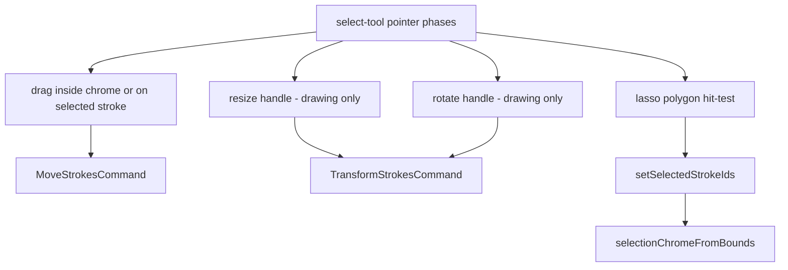

# Ink canvas: stroke selection and transform

## Why it exists

Users need to adjust ink after it is drawn: pick strokes, move them, and (in drawing mode) resize or rotate a selection as a group. The ink-canvas editor (`InkSvgCanvas` + select tool) implements this without tldraw, using page-space geometry that stays consistent under pan and zoom.

---

## Conceptual understanding

| Concept | Meaning |
|--------|---------|
| **Selection** | A set of stroke ids in React state; empty selection clears the chrome overlay. |
| **Selection chrome** | Oriented bounding box in page space (centre, width, height, rotation) derived from selected strokes. |
| **Preview** | During drag, resize, or rotate, chrome and stroke offsets update live; geometry is **baked** into strokes on pointer up via undoable commands. |
| **Writing vs drawing** | Both modes support lasso, tap-select, and move. **Resize and rotate handles** render only when `writingMode` is false (drawing embeds / drawing dedicated). |

**Dominant hand** (vault setting + `dominantHandAtom`) mirrors resize and rotate handle positions on the selection frame. Left-hand users get the resize handle on the opposite corner and a counter-clockwise rotate glyph; rotate drag delta is inverted so the gesture still feels natural.

Long-press on the selection chrome (not on empty canvas) opens a small context menu with **Delete**, which removes selected strokes through the existing delete path and clears selection.

**Additive XOR:** Starting a new lasso or tap does not clear the existing selection. Strokes hit by a lasso toggle membership (selected → deselect, unselected → select). A short tap on a stroke toggles that stroke. Tap empty canvas to clear all. Dragging still starts from the selection frame interior, or from a selected stroke after moving the pointer a few screen pixels.

---

## Technical details

| Module | Role |
|--------|------|
| `tools/select-tool.ts` | Pointer phases: `idle`, `lasso`, `dragging`, `resizing`, `rotating`. |
| `selection-bounds.ts` | Axis-aligned bounds from strokes, padding, minimum size for handles. |
| `selection-chrome.ts` | Oriented frame, handle positions, hit tests, preview application. |
| `selection-transform.ts` | Scale/rotate about pivot; `rotationDeltaForDominantHand` for left hand. |
| `selection-overlay.tsx` | SVG chrome, Lucide-style resize diagonal and rotate (redo/undo) icons. |
| `utils/lasso-stroke-selection.ts` | Stroke ∩ lasso polygon (segment sampling). |
| `selection-context-menu.ts` | Long-press thresholds and “point on chrome” helper for menu routing. |
| `commands.ts` | `MoveStrokesCommand`, `TransformStrokesCommand` (undo/redo via `StrokeStore`). |
| `ink-svg-canvas.tsx` | Wires select context, overlay, selection state, long-press menu. |

Chrome is **rebuilt from stroke bounds** when the selected id set changes, not after every move/rotate bake (signature on sorted ids avoids jitter).

Settings UI lists **Left** before **Right** on the dominant-hand toggle so the control order matches common “pick your hand” wording.

---

## Technical Gotchas

- **CM embed remounts** are unrelated to selection state; unlock/edit-mode for embeds is still keyed by widget id only. Opening Obsidian Settings can force-rebuild Live Preview widgets and drop unlock state — that interaction was intentionally left unchanged after an abandoned mitigation attempt in this thread.
- **Boox input lock** still applies: when the companion streams strokes, local select pointer input is suppressed like draw/erase.
- **Minimum bounds**: very small selections expand to a minimum page size so resize/rotate handles remain tappable.
- **Selected stroke tint** uses `color-mix` with `--interactive-accent` so selection is visible in both writing and drawing without hiding ink colour.
