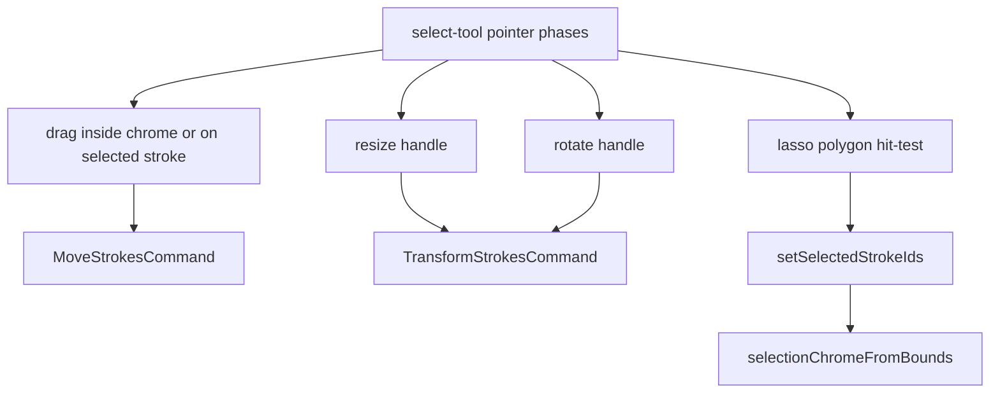

# Ink canvas: stroke selection and transform

## Why it exists

Users need to adjust ink after it is drawn: pick strokes, move them, and resize or rotate a selection as a group. The same handles work in writing and drawing. Backspace and Delete remove the selection while its box is showing. The ink-canvas editor (`InkSvgCanvas` + select tool) implements this without tldraw, using page-space geometry that stays consistent under pan and zoom.

---

## Conceptual understanding

| Concept | Meaning |
|--------|---------|
| **Selection** | A set of stroke ids in React state; empty selection clears the chrome overlay. |
| **Selection chrome** | Oriented bounding box in page space (centre, width, height, rotation) derived from selected strokes. |
| **Preview** | During drag, resize, or rotate, chrome and stroke offsets update live; geometry is **baked** into strokes on pointer up via undoable commands. |
| **Writing vs drawing** | Both modes support lasso, tap-select, move, resize, and rotate. Writing page height still grows from the existing inviting-height path when a transform changes the ink. |

**Dominant hand** (vault setting + `dominantHandAtom`) mirrors resize and rotate handle positions on the selection frame. Left-hand users get the resize handle on the opposite corner and a counter-clockwise rotate glyph; rotate drag delta is inverted so the gesture still feels natural.

Long-press or right-click on the selection chrome (not on empty canvas) opens a small context menu with **Delete**, which removes selected strokes through `RemoveStrokesCommand` and clears selection.

**Keyboard delete:** While the select tool is active and the selection is not empty, plain **Backspace** or **Delete** runs that same command. The listener is capture-phase on the canvas window so the note does not also delete a character. Key repeat is ignored. Cmd, Ctrl, and Alt chords stay with the host (word delete, undo). A text field (the note, an input, a textarea) keeps Backspace.

**Focus:** Hovering an unlocked embed does not move the caret. A click, a drag, or a selection change (made, added, or removed) focuses the canvas container (`tabIndex={-1}`, `preventScroll`) so Delete and the other shortcuts reach the ink. If the host later leaves focus on `document.body`, the last canvas that was interacted with still owns Backspace and Delete. A touch pointer entering the embed blurs only a text field, which dismisses the on-screen keyboard without dropping embed focus. Mouse and pen hover do not blur. See [Pen vs. Finger Input Handling](pen-vs-finger-handling.md).

**Additive XOR:** Starting a new lasso or tap does not clear the existing selection. Strokes hit by a **long** lasso toggle membership (selected → deselect, unselected → select). A short tap on a stroke toggles that stroke. **Short tap outside the selection chrome** (press start outside the oriented bounding box, movement under `SELECT_STROKE_DRAG_THRESHOLD_SCREEN_PX`) clears the whole selection — even when the pen emits many pointermove samples (Boox). Dragging still starts from the selection frame interior, or from a selected stroke after moving the pointer a few screen pixels.

**Finger + select:** When finger drawing is off, single-finger touch on the canvas still runs the select tool (tap/lasso/deselect). Long-press on the selection chrome alone opens the delete menu.

**Tool switching (writing + drawing):** `selectedIds` and `selectionChrome` stay in memory when you switch to pen or eraser. Bounds, handles, lasso, and stroke highlight (accent tint / high-contrast halo) show **only** while the select tool is active — same behaviour in both ink-canvas writing and drawing editors (`InkSvgCanvas` + `InkCanvasDrawingMenu`). Returning to the arrow restores the previous pick without re-lassoing.

---

## Technical details

| Module | Role |
|--------|------|
| `tools/select-tool.ts` | Pointer phases: `idle`, `lasso`, `dragging`, `resizing`, `rotating`. |
| `selection-bounds.ts` | Axis-aligned bounds from strokes, padding, minimum size for handles. |
| `selection-chrome.ts` | Oriented frame, handle positions, hit tests, preview application. |
| `selection-transform.ts` | Scale/rotate about pivot; `rotationDeltaForDominantHand` for left hand. |
| `selection-overlay.tsx` | SVG chrome: bounds **fill underlay** (below strokes), then bounds **stroke** + handles above ink. |
| `utils/lasso-stroke-selection.ts` | Stroke ∩ lasso polygon (segment sampling). |
| `selection-context-menu.ts` | Long-press thresholds, “point on chrome”, and whether Backspace/Delete belong to this canvas. |
| `commands.ts` | `MoveStrokesCommand`, `TransformStrokesCommand` (undo/redo via `StrokeStore`). |
| `ink-svg-canvas.tsx` | Wires select context, overlay, selection state, long-press menu, and the Backspace/Delete listener; focuses the canvas on pointer down, pointer up, and selection-id changes; tints selected strokes in `StrokePath`. |
| `ink-svg-canvas.scss` | `.ink-stroke--selected` `saturate(1.35)` alongside accent `color-mix` fill. |

Chrome is **rebuilt from stroke bounds** when the selected id set changes, not after every move/rotate bake (signature on sorted ids avoids jitter).

Settings UI lists **Left** before **Right** on the dominant-hand toggle so the control order matches common “pick your hand” wording.

---

## Technical Gotchas

- **CM embed remounts** are unrelated to selection state; unlock/edit-mode for embeds is still keyed by widget id only. Opening Obsidian Settings can force-rebuild Live Preview widgets and drop unlock state — that interaction was intentionally left unchanged after an abandoned mitigation attempt in this thread.
- **Boox input lock** still applies: when the companion streams strokes, local select pointer input is suppressed like draw/erase.
- **Minimum bounds**: very small selections expand to a minimum page size so resize/rotate handles remain tappable.
- **Selected stroke tint** mixes **60%** `--interactive-accent` into the stroke fill (`INK_SELECTED_STROKE_ACCENT_MIX_PERCENT` in `ink-svg-canvas.tsx`) plus a light saturation filter — only when the select tool is active (`showSelectionVisuals` in `ink-svg-canvas.tsx`).
- **Drag vs toggle on a selected stroke** uses `SELECT_STROKE_DRAG_THRESHOLD_SCREEN_PX` (6px): a press without that much movement toggles the stroke off; larger movement promotes to move the whole selection.
- **High contrast user interface** recolours lasso and selection chrome to black/white (2px strokes) and adds a **4px** selected-stroke outline (black on dark theme, white on light theme) while the select tool is active; writing guides use 50% opacity in HC vs 30% in normal mode. See [High contrast user interface](high-contrast-user-interface.md) and [Ink writing guide lines](ink-writing-guide-lines.md).
- **Tap vs lasso** is classified by **screen displacement**, not lasso point count — micro-jitter on e-ink must not turn a tap into an XOR lasso.
- **Delete only while the box is showing.** Pen and eraser keep `selectedIds` but hide the chrome. Backspace and Delete do nothing until the select tool is active again.
- **Do not focus the canvas on hover.** `FingerBlocker` `pointerenter` used to blur whatever was focused. On a desktop that pulled the caret out of the note as soon as the pointer crossed an unlocked embed. Blur runs only for `pointerType === 'touch'`, and only when the active element is a text field.
- **Two open editors.** Each canvas listens for Backspace/Delete. When focus is on `document.body`, only the canvas remembered from the latest click, drag, or selection change deletes. Unmount releases that memory.
