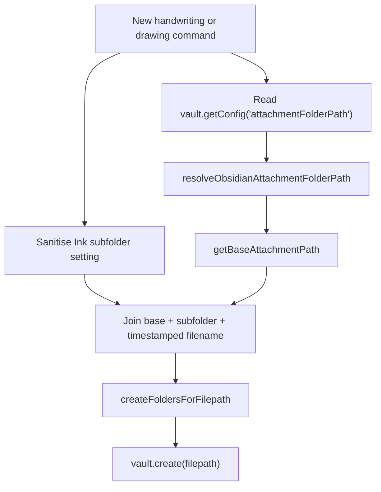
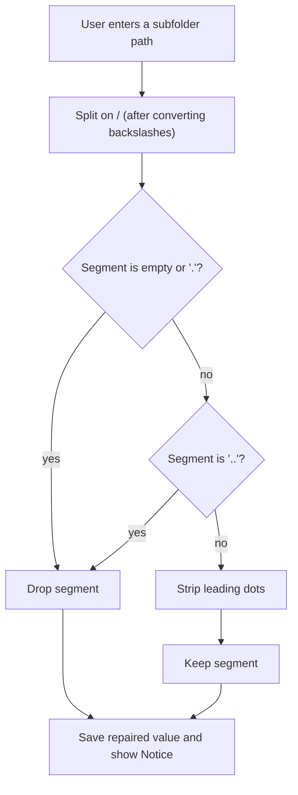

# Ink file organisation

## Why it exists

Ink stores every writing and drawing as a real SVG attachment, so where those files land matters. Obsidian offers four attachment-folder modes, and Ink adds its own writing/drawing subfolders on top of them. Two problems made this fragile:

1. Reading Obsidian's attachment folder **created** the folder as a side effect, leaving empty `attachments/` folders behind.
2. Obsidian silently refuses folders whose names start with a dot, so a custom subfolder like `.ink/Writing` produced no folder, no ink file, and no error.

This page covers how Ink resolves a destination path, and how it repairs a user-entered subfolder instead of failing quietly.

---

## Conceptual understanding

A new ink file's vault path is built from three stacked pieces:

```
<base attachment path> / <writing or drawing subfolder> / <timestamped filename>.svg
```

| Piece | Comes from | Chosen in |
|---|---|---|
| **Base attachment path** | Obsidian's `attachmentFolderPath` setting, or the note's own folder | Obsidian → Files and links |
| **Subfolder** | Ink's `writingSubfolder` / `drawingSubfolder` settings | Ink → Customise file organisation |
| **Filename** | Date-based, de-duplicated with a ` (2)` suffix | Automatic |

Ink only chooses the base path when the user has **Customise file organisation** switched on. Otherwise the defaults (`Ink/Writing`, `Ink/Drawing`) apply.

### Obsidian's four attachment-folder modes

These were confirmed against a live vault, because the setting's stored values are not self-explanatory:

| Stored `attachmentFolderPath` | Meaning | Ink base path |
|---|---|---|
| `/` or empty | Vault root | `''` |
| `./` | Same folder as the note | the note's folder |
| `./sub` | Subfolder of the note's folder | `<note folder>/sub` |
| `Attachments/Ink` | Fixed vault-relative folder | `Attachments/Ink` |

Ink's own setting (`noteAttachmentFolderLocation`) can override this to `root` or `note`, but when set to `obsidian` it follows the table above.

---

## Flows

### Resolving a destination



Only the final `createFoldersForFilepath` step is allowed to create folders. Resolving the path must not touch the vault.

### Repairing a subfolder



Repair runs in **two places**: when the user saves the field, and again when the path is read. The second pass matters because an already-saved `.ink/Writing` value must self-heal rather than keep failing.

---

## Technical details

| Piece | Location | Responsibility |
|---|---|---|
| Attachment mode resolver | `logic/utils/obsidian-attachment-folder.ts` | `resolveObsidianAttachmentFolderPath()` — pure mapping from setting value to folder path |
| Config reader | `logic/utils/obsidian-interfaces.ts` | `getObsidianAttachmentFolderPath()` — reads `attachmentFolderPath` without vault writes |
| Subfolder sanitiser | `logic/utils/ink-subfolder-path.ts` | `sanitiseInkSubfolderPath()`, `describeInkSubfolderPathChange()` |
| Subfolder accessors | `logic/utils/getSubfolderPaths.ts` | `getWritingSubfolderPath()`, `getDrawingSubfolderPath()` — sanitise on read |
| Path assembly | `logic/utils/file-manipulation.ts` | `getNewTimestampedWritingSvgFilepath()` and siblings |
| Settings UI | `settings-tab.ts` → `insertFileOrganisationSection()` | Repairs the field on blur/Enter and writes the value back |
| Folder creation | `logic/utils/createFoldersForFilepath.ts` | Creates each missing cascade segment, logs the outcome |

`Vault.getConfig()` exists at runtime but is missing from the public Obsidian typings, so it is reached through a narrow local interface. If it is unavailable, Ink treats the base path as the vault root rather than falling back to the folder-creating API.

### Repair reasons

Each repair reports a `reason` so the user sees one clear explanation rather than a generic warning:

| Reason | Cause | User-facing message |
|---|---|---|
| `leading-dot-segment` | Segment starts with `.` | Obsidian cannot create folders whose names start with a dot… |
| `parent-traversal` | Segment is `..` | Ink files cannot be saved outside the vault… |
| `backslash` | Path uses `\` | Backslashes were converted to forward slashes… |
| `extra-slash` | Repeated or trailing `/` | Repeated or trailing slashes were removed… |

A missing `writingSubfolder` **setting** is intentionally not replaced with the default at read time — it means "put the file directly in the base folder". But clearing the settings **field** falls back to the default value (`enteredValue || fallbackValue` in `applyFolderValue`), so a user who empties the box gets `Ink/Writing` back rather than root placement.

---

## Technical Gotchas

### Never call `getAvailablePathForAttachment` to read the folder

`fileManager.getAvailablePathForAttachment()` returns the resolved attachment path, but it also **creates the parent folder** as a side effect. Ink previously called it purely to learn the folder name, which left an empty `attachments/` folder for anyone using a custom Ink location. Resolving from the stored setting is a pure calculation.

If you need the resolved folder and are about to ship a new file anyway, creating the folder is harmless. The rule is only that the *read* path must not write.

### Sanitising on read, not just on save

A value saved before this repair existed is still in the user's `data.json`. Sanitising only in the settings UI would leave those users broken forever. `getWritingSubfolderPath()` / `getDrawingSubfolderPath()` therefore sanitise every time.

### Empty subfolder is a valid answer

`sanitiseInkSubfolderPath('')` returns `''` with `wasChanged: false`. Do not treat an empty result as an error. A blank **stored** setting means "place the file directly in the base folder", which is a legitimate state — for example after `getNewTimestampedWritingSvgFilepath` reads `writingSubfolder` from an older `data.json`.

Note the distinction: the settings **field** maps an empty entry back to the default, so clearing the box in the UI does not produce root placement.

### `..` is dropped, not resolved

`Ink/../Writing` becomes `Ink/Writing`, not `Writing`. Dropping the segment keeps the file inside the folder the user was editing rather than walking the path.

### Debug logging

`logResolvedAttachmentFolder()` reports the chosen base path and the resolved Obsidian folder at debug level. The original attachments-folder bug was invisible because nothing recorded which path was chosen.

---

## Related docs

- [File format and conversion](file-format-and-conversion.md) — how ink files are written and converted
- [Plugin memory and persistence](plugin-memory-and-persistence.md) — settings vs vault files
