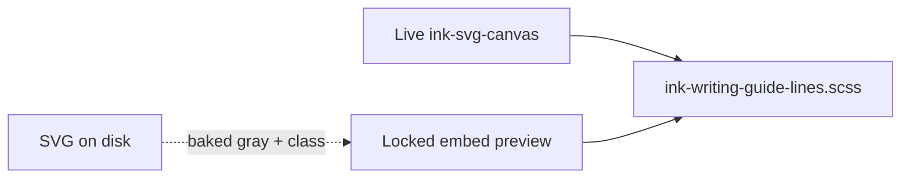

# Ink writing guide lines

## Why it exists

Horizontal guides help line up handwriting in writing mode. They must look the same when you are editing, when the embed is locked in a note, and when high contrast is on — without changing saved pen ink colours.

## Conceptual understanding

Guide lines are **not** pen strokes. They are thin horizontal rules only in writing mode (and in exported writing SVGs). Ink applies one shared CSS recipe everywhere the app paints them:

| Property | Value |
|----------|--------|
| Colour | `currentColor` (inherits theme text on the SVG host) |
| Opacity | **30%** (`stroke-opacity: 0.3`) |
| Width | **1 CSS pixel** (`stroke-width: 1px`, `vector-effect: non-scaling-stroke`) |

High contrast does **not** recolour or thicken guides. Selected-stroke halos and selection chrome are separate (see [High contrast user interface](high-contrast-user-interface.md) and [Ink canvas: stroke selection and transform](ink-canvas-selection.md)).

Saved files still bake `#888888` at `stroke-opacity="0.3"` on each `<line>` for print and out-of-Obsidian fallback. In Obsidian, `ink-writing-guide-lines.scss` overrides stroke to `currentColor` at 30% opacity.

## Technical details

| Surface | Selector / class | Notes |
|---------|------------------|--------|
| Live editor | `.ink-writing-guide-line` inside `.ink-svg-canvas` | Lines sit in the camera `<g>`; presentation `vectorEffect="non-scaling-stroke"` matches CSS |
| Locked / reading preview | `.ddc_ink_writing-embed-preview line` | Inlined SVG from `vault.read` |
| Exported SVG | `.ink-type-writing-line` | Emitted by `renderWritingStrokesToSvg` in `svg-export.ts` |

Import: `main.ts` loads `src/styles/ink-writing-guide-lines.scss` globally.

Live canvas sets `color: var(--text-normal)` on `.ink-svg-canvas` so `currentColor` matches locked embeds.

## Technical Gotchas

1. **Legacy tldraw editor SCSS** — `.ddc_ink_writing-editor line` used to style **all** `<line>` elements at 2px and `--color-base-50`, which overrode live ink-svg-canvas guides. That rule is scoped to `.tl-container line` only; ink-svg-canvas uses `.ddc_ink_writing-editor .ink-writing-guide-line` in the shared stylesheet so specificity wins.
2. **Tap vs lasso on e-ink** — Unrelated to colour, but guide lines share the same canvas as selection; do not thicken guides for “visibility” when high contrast already handles selection chrome separately.
3. **Old vault files** — SVGs saved before 0.3 opacity may still carry `stroke-opacity="0.5"` in markup; CSS in Obsidian still forces **0.3** for `.ink-type-writing-line`.
4. **Pen stroke theming** — Guide rules target `line` and guide classes only. Pen paths use `ink-svg-preview-theme.scss` and stroke classes; see [Ink colours and theming](ink-colours-and-theming.md).

## See also

- [Ink colours and theming](ink-colours-and-theming.md) — baked vs themed colours for strokes and lines
- [High contrast user interface](high-contrast-user-interface.md) — canvas chrome without guide recolour
- [Ink canvas: stroke viewport culling](ink-canvas-stroke-viewport-culling.md) — guide line index culling while scrolling
