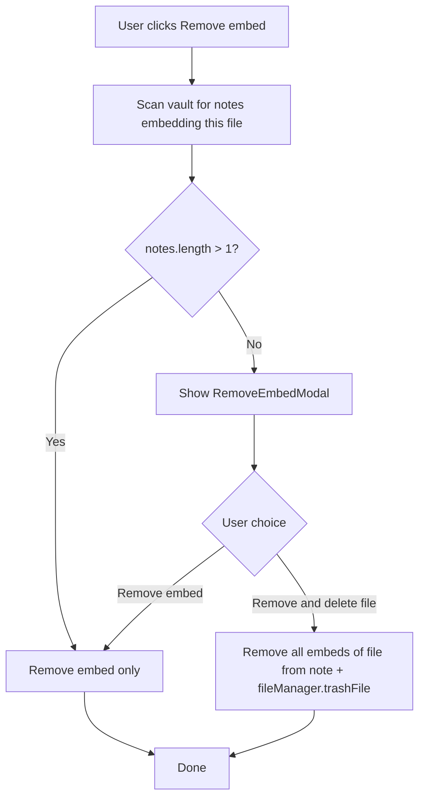
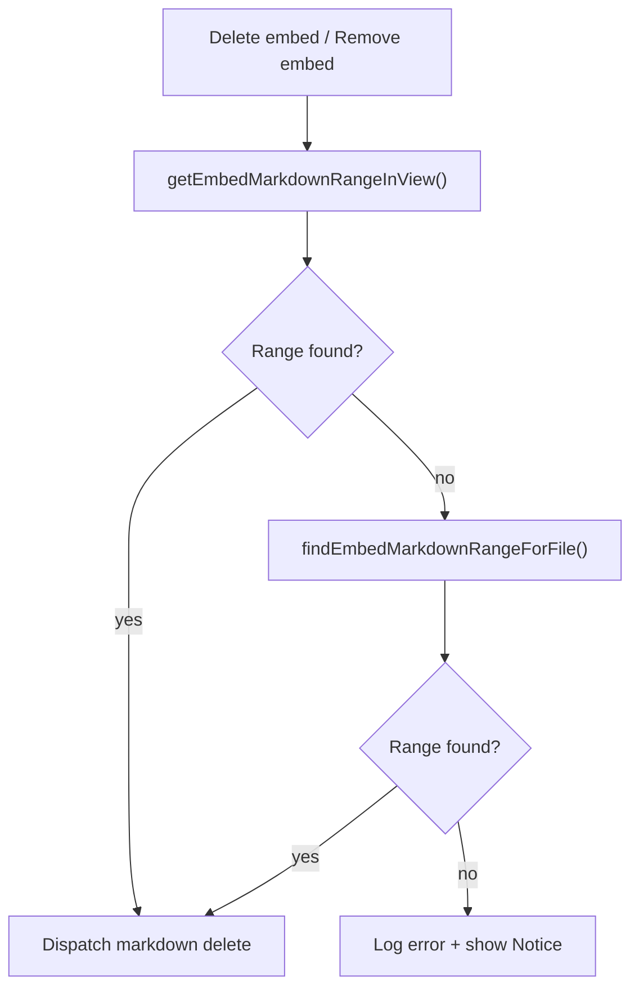

# Remove embed

## Why it exists

When a user removes an ink embed from a note, the referenced SVG file may still exist in the vault. If that file is embedded nowhere else, the user may want to delete it to avoid orphaned files. This doc describes how the plugin offers that choice.

## Conceptual overview

The remove-embed flow scans the vault to see whether the embedded file is referenced in any other notes. If it is, the embed is removed without prompting — the file stays. If it is only in the current note, a modal asks whether to remove only the embed or also delete the file from the vault.

## Flow



- **File embedded in multiple notes** — Remove embed only, no prompt. The file remains for other notes.
- **File embedded only in current note** — Modal with two options: "Remove embed" or "Remove and delete file".
- **"Remove embed"** — Removes this embed from the note via the CodeMirror widget (same as before). The file stays.
- **"Remove and delete file"** — Removes all embeds of that file from the current note (including when the same file is embedded multiple times), then deletes the file from the vault.

## Technical implementation details

| Layer | File | Responsibility |
|-------|------|---------------|
| Flow | `logic/utils/remove-embed-flow.ts` | `openRemoveEmbedFlow()` — opens modal and wires callbacks |
| Modal | `modals/remove-embed-modal/remove-embed-modal.ts` | Scans vault, shows progress, presents two buttons when file is only in current note |
| Utility | `logic/utils/convert-file-embeds.ts` | `findNotesContainingFileEmbed()`, `removeAllEmbedsOfFileFromNote()` |
| Range lookup | `logic/utils/embed-markdown-range.ts` | Decoration range, plus a file-path fallback used when it fails |
| Embeds | `drawing-embed.tsx`, `writing-embed.tsx` | "Remove embed" action calls `openRemoveEmbedFlow` instead of `props.remove()` directly |

Scope: **current format only** (`formats/current/`). The v1 format keeps the original remove behaviour.

### Finding the embed line: decoration range, then file path

Removing an embed needs the exact markdown range of its line. `getEmbedMarkdownRangeInView()` finds it from the widget's CodeMirror decoration, which is normally correct and precise.

That lookup can fail: the widget may have been rebuilt, or the line may no longer match the strict embed regex (for example after an edit that changed its shape). Previously the delete then returned silently and the menu appeared to do nothing.

The removal path therefore falls back to `findEmbedMarkdownRangeForFile()`, which locates the line by the **file path it references**:



The fallback matches any image alt (a transcript replaces the `InkWriting` / `InkDrawing` placeholder), anchors on the `Edit Writing` / `Edit Drawing` link so unrelated images are skipped, escapes regex characters in the path, and includes the leading space the embed builders write. It returns `null` rather than guessing when the file is not embedded.

A failed removal is no longer silent: it logs through `universal-dev-logging` and shows a notice telling the user to remove the line manually.

## Testing

The remove-embed feature has unit and e2e tests.

**Unit tests**

- `convert-file-embeds` (`ConvertFileEmbeds.test.ts`): `removeAllEmbedsOfFileFromNote` isolation — embed removed, other content preserved, other embeds untouched, `vault.modify` called once.
- `remove-embed-flow` (`remove-embed-flow.test.ts`): `openRemoveEmbedFlow` modal wiring, callbacks, correct file deleted.
- `RemoveEmbedModal` (`remove-embed-modal.test.ts`): Scan phase, notes > 1 vs = 1, button handlers, cancel, error handling.
- `embed-markdown-range` (`embed-markdown-range.test.ts`): decoration range expansion, plus `findEmbedMarkdownRangeForFile` — matching by path, transcript alts, escaped regex characters, wrong embed type, and not-embedded files.
- `DrawingEmbed` / `WritingEmbed`: Remove embed calls `openRemoveEmbedFlow` vs fallback when `sourceMdFile` is missing.

**E2E tests**

- `remove-embed-modal.e2e.ts`: Full user flow — modal scan → confirm, multi-note (no modal), "Remove embed", "Remove and delete file", cancel, drawing flows, file in two notes. Overflow menu tests (7, 8) are skipped because the Obsidian Menu DOM is not reliably findable in e2e; flow coverage is via programmatic tests.
- `desktop-bug-fixes.e2e.ts` § `#69 remove embed`: deletes the embed line and preserves the rest of the note, finds the embed by file path alone (the no-widget case), and returns no range for a file that is not embedded.

**How to run**

```bash
# Unit
npm test

# E2E (run from obsidian_ink root; generates vault and runs all e2e specs)
npm run test:e2e:spec -- tests/e2e/remove-embed-modal.e2e.ts
```

QA vault section **15 – Remove Embed** provides notes and fixtures for the e2e tests.

## Technical gotchas

- **Same file embedded multiple times in one note**: "Remove and delete file" removes all such embed lines before deleting the file, so no broken references remain.
- **sourceMdFile required**: The flow needs the markdown note containing the embed. If `sourceMdFile` is missing (edge case), the action falls back to immediate removal without the prompt.
- **Obsidian trash**: deletion uses `app.fileManager.trashFile()` so the user’s Obsidian trash-vs-permanent-delete preference is respected (do not use `vault.delete()` for this path).
- **Silent no-ops are regressions**: both the writing and drawing `removeEmbed()` paths must log and notify when no range is found. An empty `return` is indistinguishable from a broken menu item.
- **The fallback finds the first match only.** When the same file is embedded twice in one note, the decoration range is still preferred for precision. The path fallback removes only the first occurrence — `removeAllEmbedsOfFileFromNote()` handles the multi-embed case.
