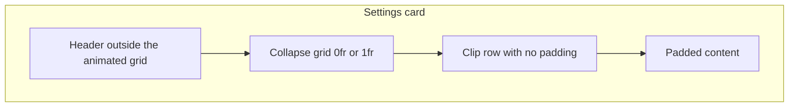

# Settings section cards

Ink settings groups related controls in cards. A card is a rounded outline with a header bar. Some headers open and close the body underneath. The outline follows the card and sits behind the header fill, so the stroke is hidden wherever the header covers it.

## Conceptual understanding

An open header is rounded on top and flat along the bottom, with square bottom corners. A closed header is rounded on every corner, using the same radius as the card (`--radius-l`). The flat bottom stays in place for the whole close animation, then the corners round once the body has shut. Opening flattens the bottom on the same frame the body starts to grow, so the body comes out under a straight edge.

Gray expandable headers — Getting started, Experimental changes, and This plugin is in beta — use one wash for the bar and the outline: `rgba(var(--background-modifier-hover-rgb), 0.2)`. The Almost Useful account card uses `--interactive-accent` for both. See [Almost Useful account](almostuseful-account.md).

Writing and Drawing use the same body shell and open when those features are enabled. Their headers are not clickable, so they keep the flat bottom. Plugin development uses the shell too, but it is not inside a collapsing wrapper, so its body stays open.

Getting started ends with **Recent changes...** and **Welcome tips...**. The shorter labels fit the card on iPad. They open the version notice and the welcome series. See [Version and welcome notices](version-and-welcome-notices.md).

## Technical details

`createCollapsibleSectionContent` builds the body:

1. `ddc_ink_controls-collapse` — the grid whose row animates `0fr` ↔ `1fr`.
2. `ddc_ink_controls-collapse-inner` — the grid item. `min-height: 0` and `overflow: hidden`. No padding.
3. `ddc_ink_controls-content` — the padded body (`0.8em`, inline start `1em`).

`ddc_ink_expanded` on `ddc_ink_section-wrapper` sets the row to `1fr`. Without that class the row is `0fr`. Duration is `--ddc-ink-section-collapse-duration` (`0.5s`) with `cubic-bezier(0.4, 0, 0.2, 1)`. The closed header’s `border-radius` uses that same duration as a delay and a `0s` transition, so the corners snap only after the height animation. Expanding removes that rule, so the flat bottom returns immediately.

The card outline is a `::before` border on `ddc_ink_controls-section`, color `--ddc-ink-section-outline`. The header is `z-index: 2` with an opaque `--background-primary` base. A wash `::before` on clickable headers matches the outline color, so the stroke disappears under the fill. Gray sections with a clickable header set the outline variable to the wash. Other cards keep `--setting-items-background`. iPad `.setting-item` margin and radius are overridden with `!important` so the header sits flush on the card curve.

| Piece | Where |
|---|---|
| Shell | `collapsible-section-content.ts` |
| Shape, outline, close timing | `settings-tab.scss` |
| Accent card | `almostuseful-account-section.scss` sets `--ddc-ink-section-outline: var(--interactive-accent)` and removes the gray wash |
| Getting started labels | `settings-tab.ts` — `Recent changes...`, `Welcome tips...` |

## Technical Gotchas

- **Do not put padding on the closing grid item.** Vertical padding becomes a minimum height. The body then stops short of closed. Padding belongs on `ddc_ink_controls-content`, inside `ddc_ink_controls-collapse-inner`.
- **Do not put the header in the animated grid.** An `auto` header row next to a blending `1fr` row grows and then shrinks during the close. The header stays a block above `ddc_ink_controls-collapse`.
- **Close `0fr` to `1fr`, not `0px`.** `1fr` and `0px` do not blend. iPad treats that change as a jump when the ease is halfway, about 200ms after the tap. The corners, which update immediately, then look early.
- **The corner delay lives on the closed rule.** CSS uses the destination transition. Collapsing waits `--ddc-ink-section-collapse-duration`. Expanding drops the rule and flattens on the same frame. A delay on the open rule would round the bottom while the body is still visible.
- **The accent header must clear the gray wash.** `.ddc_ink_controls-header--clickable::before` paints the wash. The account card sets `content: none` on that layer and uses a solid `--interactive-accent` background so the accent stroke stays hidden under the fill.
- **Plugin development is not a collapsing section.** It calls `createCollapsibleSectionContent` but its parent is `ddc_ink_section`, not `ddc_ink_section-wrapper`. The `0fr` rules do not apply, so the links stay visible.
