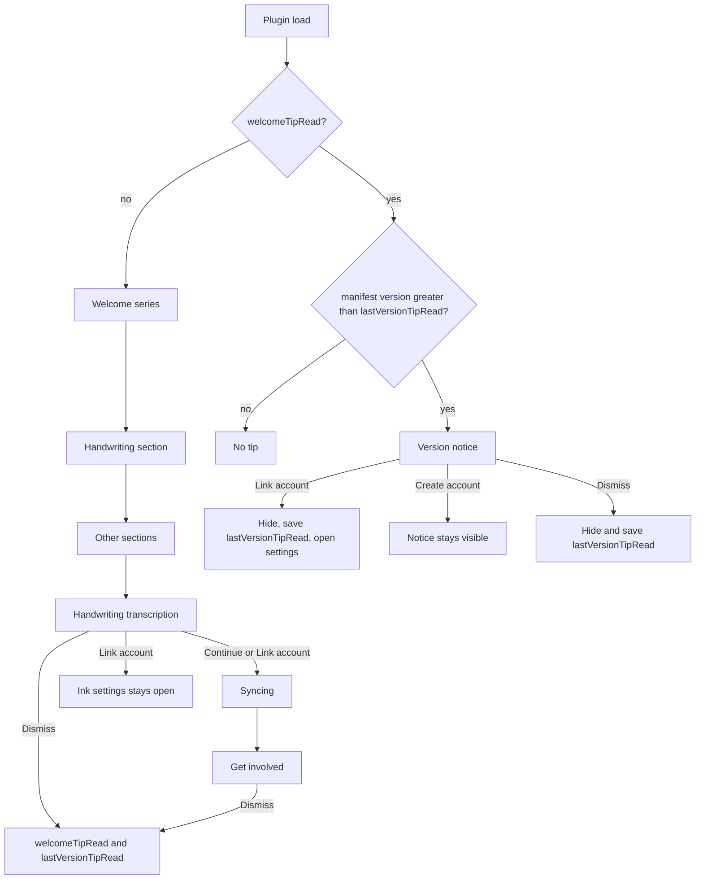

# Version and welcome notices

## Why it exists

Ink uses persistent Obsidian notices for first-run onboarding (`welcome-notice.ts`) and for “what’s new” after a plugin upgrade (`version-notices.ts`). Both share `notice-components.ts` so scroll layout, footer CTAs, and pointer handling stay consistent. Version tips gate on vault-synced `onboardingTips.lastVersionTipRead` in `data.json`; welcome tips use `welcomeTipRead`.

---

## Conceptual understanding

**Welcome flow** — Multi-page carousel on first load when `welcomeTipRead` is false. A first install does not also show the version notice (`showOnboardingTips_maybe` skips it). Finishing the series sets both `welcomeTipRead` and `lastVersionTipRead`, so the upgrade tip does not appear on the next launch.

Pages, in order:

| Page | What it tells the user | Footer |
|------|------------------------|--------|
| Welcome to ink | Pen input in Markdown notes | **Read now** continues. **Remind me later** hides and does not mark the series read |
| Inserting handwriting sections | Command `"Ink: new handwriting section"` | **Continue** |
| Other sections | **Drawings:** `"Ink: new drawing"`. **Trace photos:** `"Ink: Insert handwriting/drawing from photos"` (the palette name of `create-handwriting-from-photo`) | **Continue** opens the account page |
| Handwriting transcription | Optional Almost Useful subscription for turning handwriting into searchable text | **Continue** and **Dismiss** |
| Syncing with your vault | Ink files sync with the vault; Obsidian Sync needs “sync all other types” | **Continue** |
| Get involved | Bug reports and the feature-demo and social links | **Dismiss** finishes the series |

The transcription page is not last. It sits directly after **Other sections** because a new install never sees the version notice’s account controls. **Continue** replaces it with the syncing page and does not mark the series finished. **Dismiss** hides it and finishes the series anyway, so syncing and **Get involved** are skipped. **Link account** opens Ink settings and then does the same advance as **Continue**. It does not finish the series. **Create account** opens portal sign-up and leaves this page up.

**Version flow** — Single-page **Changes in Ink v…** notice when the installed manifest version is newer than `lastVersionTipRead` (semver compare; `-beta` suffix stripped). **Dismiss** hides the notice and writes `lastVersionTipRead` to the current manifest version. `showRecentChanges()` always shows the current page for manual QA (command/settings entry).

**Account controls on the version notice** — After the changelog, the same centred **Link account** / **Create account** stack as the welcome transcription page (`appendAlmostUsefulNoticeAccountCta`). On this notice only, **Link account** hides the notice, marks `lastVersionTipRead`, then opens Ink settings so the notice does not sit over the account section. **Create account** does not hide it. **Dismiss** hides it and marks the tip read.

**Interaction rule:** **Create account** leaves whichever notice is open, because the browser covers Obsidian and the explanation should still be there. **Link account** is not the same on both notices. The version notice ends so settings are uncovered. The welcome transcription page advances to syncing instead, and settings opens underneath that next tip.

---

## Technical details

| Piece | Location |
|-------|----------|
| Version gate + changelog | `version-notices.ts` — `showVersionNotice`, `showChanges` |
| Welcome carousel, including Other sections and the transcription page | `welcome-notice.ts` |
| Shared Link account / Create account stack | `almostuseful-link-account-button.ts` — `appendAlmostUsefulNoticeAccountCta` |
| Onboarding gate | `main.ts` — `showOnboardingTips_maybe` |
| Template, footer bar, body CTA row | `notice-components.ts`, `notice-components.scss` |
| Persistence | `onboardingTips.welcomeTipRead` and `lastVersionTipRead` in vault `data.json` |
| Welcome e2e | `tests/e2e/onboarding.e2e.ts` clicks `.ddc_ink_notice-cta-bar .ddc_ink_primary-btn` so the transcription page’s **Continue** is used, not **Link account** |
| QA pre-seed | `qa-test-vault/generate.mjs` sets `lastVersionTipRead` so `open-qa` skips the popup |

**Notice helpers**

- `createNoticeBodyCtaRow(scrollAreaEl)` — `.ddc_ink_notice-body-cta-row` flex container in scroll content.
- `createNoticeBodyCtaButton(parentEl, label)` — primary button inside that row (replaces the old one-button-per-wrapper API).

---

## Technical Gotchas

- **Create account must stay open** — The shared helper wires that click. Hiding on that link loses the explanation when the browser overlays Obsidian.
- **Welcome Link account must not finish the series** — It opens settings and advances to syncing. Copying the version-notice handler here marks `welcomeTipRead` and drops the remaining pages.
- **Welcome transcription Dismiss does finish the series** — It sets both onboarding flags. **Continue** on that page does not.
- **Welcome transcription copy is not the settings description** — The page says an optional Almost Useful account is a subscription for transcribing handwriting into searchable text. Settings keeps its own Link account description.
- **`showRecentChanges` bypasses semver** — Useful for settings “Recent changes”; does not update `lastVersionTipRead` unless the user clicks **Dismiss**.
- **Beta suffix** — `showVersionNotice` strips `-beta` before semver compare so beta builds still match the release tip version string.
- **`manifest.version` must be valid semver** — `showVersionNotice` calls `semVer.gt` on the current version during onload. `semver` throws `Invalid Version` for a two-part string such as `0.6`. That throw fails plugin load (`Plugin failure: ink`). Use three numeric parts (`0.6.0`). `semVer.valid` is only applied to `lastVersionTipRead`, so a bad current version is not skipped. The notice heading `Changes in Ink v0.6.1` is display copy and is not the string passed to `semver`.
- **Footer vs body CTAs** — Footer uses `createNoticeCtaBar` (primary/tertiary + links); scroll-body actions use the body CTA row so multiple primaries can sit on one line.

High-contrast restyle of these notices (layout-stable 1px border + 1px outline) is documented in [High contrast user interface](high-contrast-user-interface.md).
