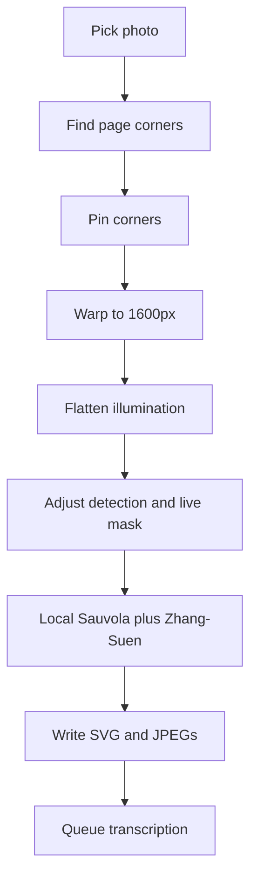

# Writing from a photo

## Why it exists

People often have handwriting on paper that they want as editable ink. The plugin traces the photo on the device into strokes, then the usual transcription queue can turn that page into searchable text. A vision model is not part of this path: a partial reply used to skip the local trace and still charge credits.

---

## Conceptual understanding

The command **Trace photo** (`create-handwriting-from-photo` in `insert-writing-from-photo.ts`) is a short wizard:

1. Pick a photo (take, choose, or paste). The dialog title is **Create Ink from Photo**.
2. Pin the page corners. Detection proposes a quad. Drag the circles if it is wrong.
3. Review how the page will become ink. Colour, contrast, ink sensitivity, and noise cleanup sit under **Adjust detection** and start from an automatic guess.
4. Convert to handwriting or to drawing. Tracing is always local.
5. The plugin writes an SVG embed plus JPEGs, opens it in ink mode, and queues transcription.

Writing embeds use the standard guide spacing `WRITING_LINE_HEIGHT` (150px). A new handwriting section created from the command palette can still follow the line height in Settings. A photo trace does not copy that setting, because guessed gaps between stroke centres are not baselines.

---

## Flows

**Page corners**

`findPageQuad` downscales to a 360px long edge and estimates paper from the centre 40% of the frame. It compares illumination-invariant colour ratios (`R/(R+G+B)` and `G/(R+G+B)`), so a shadow across the sheet stays one page. Skin and a cool screen differ from that paper colour. The fit rejects sharp angles and sides whose lengths differ by more than about 1.45. A weak score, or a quad that is already the photo, returns the full frame.

The crop dialog title is **Define the corners of the page**. Outside the quad, the overlay is Obsidian’s `--background-primary` at 50% opacity, so light mode stays light.

**Adjust**

The title is **How your photo will convert into ink**. The preview is the ink mask, always on. On open, colour and contrast stay at zero when that already yields a clean mask; otherwise they follow the page assessment. Ink sensitivity is chosen to keep strokes and penalise pepper specks, preferring a value near 70. Noise cleanup defaults on.

**Back** sits at the far left and returns to the corners. **Cancel** leaves the wizard. **Convert to drawing** and **Convert to handwriting** are both primary buttons.

**Convert**

The adjust step already warped the page to a 1600px long edge. Convert reuses that raster (`alreadyWarped`) and does not warp again. Illumination is flattened once before the trace. Colour and contrast are applied only for the mask, not written back as the saved page photo. Detail is the constant `PHOTO_TRACE_DEFAULT_DETAIL` (90). There is no detail or resolution slider.

The tracer builds a Sauvola mask, optionally removes tiny specks and isolated noise dots, bridges small gaps, drops long printed rules, thins with WASM Zhang–Suen, and turns the skeleton into ink strokes on a page `WRITING_PAGE_WIDTH` wide (2000). Noise cleanup keeps a small dot when it sits on a real stroke, so i-dots and full stops stay.

**After convert**

- The original photo is saved as a JPEG next to the SVG.
- A cropped import also saves a flattened page JPEG. Transcription uses that page when it exists, and the original photo when the pins were the full frame.
- Handwriting files store `writingLineHeight: 150`. Drawing files use the drawing grid default and a view box fitted to the strokes.
- The embed starts in ink display mode. Photo, ink, and transcript are a session toggle. The photo control is an image icon.
- In photo mode the image matches the ink frame height, and its width follows the photo. Corners are 20px, the same as the ink frame.
- `enqueueTranscriptionAfterPhotoImport` uses the handwriting transcription queue. See [writing-transcription.md](writing-transcription.md).

---

## Technical details

| Piece | Role |
|-------|------|
| `find-page-quad.ts` | Centre paper colour, then a scored quad. Full frame when the page is already the photo. |
| `flatten-page-illumination.ts` | Divides RGB by a downscaled closing of luminance so slow shadows lift. No slider. |
| `trace-from-raster.ts` | Sauvola, noise dots, rules, Chamfer radius, skeleton routing, RDP. Returns `WRITING_LINE_HEIGHT`. |
| `photo-trace.worker.ts` | Warp, and flatten only when the page is not already warped. Then colour, contrast, and the local trace. WASM thinning is inlined in `main.js`. |
| `photoTraceSauvolaK` | Sensitivity 0 → k 0.5, 75 → k 0.20, 100 → k 0.1. Higher keeps fainter ink. |
| `photoTraceSimplifyEpsilon` | Detail 90 → about 0.48px. Convert always passes `PHOTO_TRACE_DEFAULT_DETAIL`. |
| `writing-photo-adjust-modal.ts` | Live mask, auto-tune, collapsed detection controls, writing or drawing convert. |
| `ink-photo-view` | Height 100% of the ink frame, width auto, 20px radius. |

Ink sensitivity 75 is the built-in default before auto-tune. Auto-tune may pick another value in the 35–84 range.

Portal handwriting transcription is unchanged. The old centreline job is retired; historical charges still use the ledger reason `handwriting_vector`. See the portal page `docs/conceptual/HANDWRITING_VECTOR.md`.

---

## Technical Gotchas

- **Do not send the page to a vision model for centrelines.** Any non-empty reply used to skip this local trace. Transcription stays a portal job.
- **Do not estimate writing line height from stroke Y positions.** Those gaps are not baselines and packed or stretched the guides. Photo traces use `WRITING_LINE_HEIGHT` (150). The Settings line height applies when creating a handwriting section the normal way.
- **A straight pen mark simplifies to two points.** Requiring three points drops rules, underscores, and t-bars.
- **Chamfer distance is 1px even for a 1px stroke.** The radius subtracts 0.45 so strokes stay as thin as the mask. Adding a pixel, or a strong streamline, pulls letters inside their loops.
- **Noise cleanup must not delete every small component.** An i-dot and a full stop are small. They stay when a nearby component is a real stroke. Isolated pepper does not.
- **Shadows are colour, not brightness.** A luminance split cuts the page on the shadow line. Chromaticity keeps the sheet together. A white page on a white desk can still fall back to the full frame.
- **Display mode is not stored in the SVG.** Starting the new embed in photo mode made the first lock return to the photo. Create it in ink mode.
- **Photo mode must not grow the embed.** The image fills the existing ink height. A shorter container hides the cursor in the note underneath.
- **The saved page JPEG is the flattened warp, not the adjusted mask.** Colour, contrast, and sensitivity change the trace. They do not rewrite the transcription photo.
- **Do not restore a global paper-brightness clip.** A luminance floor treats shadows as “not paper” and deletes ink in dark corners. Desk leftover is `dropLargeBorderComponents`.
- **Flatten is automatic** on the page that is traced and, when cropped, on the saved page photo. Colour and contrast remain for stains, not for lighting.
