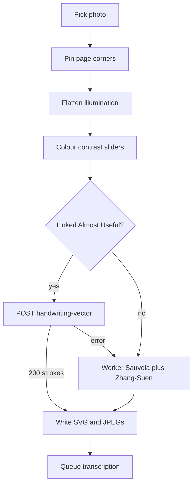

# Writing from a photo

## Why it exists

People often have handwriting on paper (or a photo of a page) that they want as an Ink writing embed. Tracing that photo into strokes keeps the note editable as ink, then the usual transcription queue can turn it into searchable text.

---

## Conceptual understanding

The command **Ink: handwriting from photo** (see `insert-writing-from-photo.ts`) is a short wizard:

1. Pick an image.
2. Pin the page corners (or use the full frame).
3. Adjust colour/contrast if the paper is stained. Lighting flatten already ran, so hand shadows should not need a slider.
4. Convert. If an Almost Useful account is linked on this device, Ink asks the portal for centreline strokes first. If that job fails, it traces locally with WASM Zhang–Suen.
5. The plugin writes an SVG embed plus JPEGs, then queues transcription like any other writing file.

**Detail** defaults to **100** (finest local centreline). **Resolution** still defaults to 1600px on the long edge. Detail only affects **local** tracing, not the portal vector job.

Progress is a log, not a single replacing line, so “Model did not return handwriting polylines” stays on screen while local tracing continues.

---

## Flows

**Convert**

- Warp always runs in the photo worker.
- Flatten divides RGB by a downscaled morphological closing of luminance so slow shadows lift and ink stays darker than local paper (`flatten-page-illumination.ts`).
- A linked session (`hasLinkedAlmostUsefulAccount`) POSTs the flattened page JPEG to `{portalOrigin}/api/jobs/handwriting-vector`.
- On success, `mapHandwritingVectorStrokesToInk` maps 0–1 (or pixel-like) polylines onto the writing page and drops full-width ruled lines.
- On 401/402/502/parse/network, the progress log records the portal message and local convert runs.

**After convert**

- Vault JPEG of the original photo plus, when cropped, a flattened page JPEG for transcription.
- `enqueueTranscriptionAfterPhotoImport` uses the handwriting transcription queue. See [writing-transcription.md](writing-transcription.md).

---

## Technical details

| Piece | Role |
|-------|------|
| `flatten-page-illumination.ts` | Close on ~320px gray, upsample, divide. No slider. |
| `trace-from-raster.ts` | Sauvola mask, specks, ruled-line removal, border blobs. Does **not** clip by global paper brightness. |
| `photo-trace.worker.ts` | Warp, flatten, colour/contrast, local trace. WASM thinning is inlined in `main.js`. |
| `almostuseful-handwriting-vector.ts` | Portal POST. HTML 200 (missing route) is `route_missing`. |
| Progress modal | Append-only stage log. |

**Detail 100** maps to simplify epsilon ≈ 0.1px and min stroke length 1px (`photoTraceSimplifyEpsilon` / `photoTraceMinPolylineLength`). Values above 100 clamp to 100.

Portal job contract and billing: portal repo `docs/conceptual/HANDWRITING_VECTOR.md`.

---

## Technical Gotchas

- **Production portal may not have `/api/jobs/handwriting-vector` until that branch is deployed.** Transcription can still work. Custom `http://localhost:3000` must be a development Ink build plus a portal that includes the route.
- **A 502 after settle has already billed Pool A.** Ink must fall back locally, not retry the same JPEG as if nothing was charged.
- **Flash Lite often returns markdown fences, truncated JSON, pixel coords, or notebook rules.** The portal recovers complete strokes and drops full-width flats; Ink also maps values `> 1.5` as pixels and drops ruling lines. Local WASM remains the reliable centreline.
- **Do not restore `clipInkToLargestPaper`.** A global luminance floor (`max(mean, 118)`) treats shadows as “not paper” and deletes Sauvola ink in dark corners. Desk leftover is `dropLargeBorderComponents`.
- **Flatten is automatic** on preview, local convert, portal JPEG, and the saved page photo. Colour/Contrast remain for stains and chalk, not for lighting.
- **Community `npm run build` ignores Custom portal origin** (`isInkDevelopmentBuild`). Use `npm run dev` / `open-qa` when pointing at localhost.
